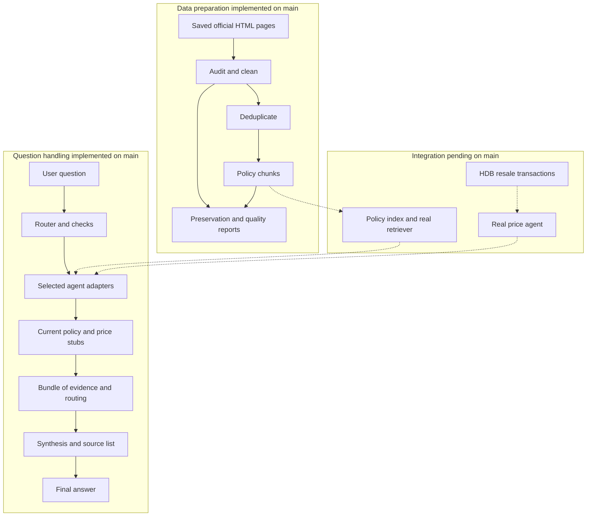
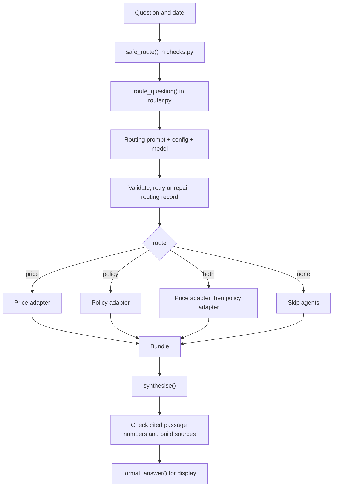

# How the project works and how the parts connect

Snapshot: local `main` at commit `e59d5a1`, reviewed on 22 October 2026. This guide describes the files currently on `main`; references to teammates' branches in older documents do not mean that their code has been merged.

## 1. The overall idea

The project is building **AskGov SG**, an assistant for questions about Singapore HDB flats, CPF housing rules and HDB resale prices.

It needs two kinds of evidence:

- **Policy documents** explain rules, eligibility, procedures and amounts written in rules, such as housing grants.
- **Resale transactions** explain what flats actually sold for, such as median prices for a town and period.

The supervisor decides which evidence a question needs. Specialist agents supply that evidence. Synthesis turns it into a readable answer.

There are two separate processes: **prepare the data before questions arrive**, then **handle each question when it arrives**. The missing connection on `main` is the real retrieval/price implementation: prepared policy chunks exist, but the running supervisor currently receives sample agent responses.



Solid arrows show implemented flow. Dotted arrows show integration still needed. A **stub** is a function that returns fixed fake data so other parts can be built and tested.

## 2. What is already on main?

| Component | Current state | Where to look |
| --- | --- | --- |
| Raw-file audit, HTML cleaning and deduplication | Implemented; outputs and reports committed | [scripts](../scripts/), [reports](../reports/) |
| Structure-aware policy chunking | Implemented; 587 chunks from 42 documents | [chunks.jsonl](../data/processed/chunks.jsonl), [chunking summary](../reports/chunking_summary.md) |
| Data quality and cleaning preservation checks | Implemented; conditions still require review | [quality summary](../reports/data_quality_summary.md) |
| LLM router and output checks | Implemented | [router.py](../agents/supervisor/router.py), [checks.py](../agents/supervisor/checks.py) |
| Supervisor orchestration and agent adapters | Implemented; both agents configured as stubs | [pipeline.py](../agents/supervisor/pipeline.py), [adapters.py](../agents/supervisor/adapters.py) |
| Answer synthesis and source formatting | Implemented; model writes answer, code builds source list | [synthesis.py](../agents/supervisor/synthesis.py) |
| Real policy retrieval/index | Not present on this branch; adapter expects `src/policy_retriever.py` | [policy integration contract](p2_supervisor_contract.md) |
| Real price agent | Not implemented in the adapter; raises `NotImplementedError` | [adapters.py](../agents/supervisor/adapters.py) |
| Routing practice evaluation | 20/20 questions match all three scored labels in saved run | [saved results](../evaluation/results/routing_supervisor_v1_20261019_1650.csv) |
| Full answer evaluation and user interface | No implementation present on this `main` snapshot | Integration work remains |

The saved routing score measures classification on a small practice set. It does not establish retrieval quality, policy correctness or final-answer accuracy.

## 3. Process A: turn saved pages into usable policy chunks

This is an offline preparation process. It does not run again for every question.

| Step | Script | Reads | Produces | Why the next step needs it |
| --- | --- | --- | --- | --- |
| 1. Audit | [file_audit.py](../scripts/file_audit.py) | Saved HTML under `data/raw/` | [file_inventory.csv](../reports/file_inventory.csv) | Gives files stable IDs, source metadata, duplicate decisions and capture warnings |
| 2. Clean | [html_cleaning.py](../scripts/html_cleaning.py) | Raw HTML + inventory | [cleaned_documents.jsonl](../data/cleaned/cleaned_documents.jsonl), [cleaning report](../reports/cleaning_report.csv) | Removes page noise while retaining structured content |
| 3. Deduplicate | [deduplication.py](../scripts/deduplication.py) | Cleaned documents + inventory | [deduplicated_documents.jsonl](../data/cleaned/deduplicated_documents.jsonl), [duplicate report](../reports/duplicate_report.csv) | Gives chunking a controlled set of documents |
| 4. Chunk | [chunking.py](../scripts/chunking.py) | Deduplicated documents + chunk settings | [chunks.jsonl](../data/processed/chunks.jsonl), [chunking report](../reports/chunking_report.csv) | Creates smaller passages for future retrieval |
| 5. Check cleaning preservation | [content_validation.py](../scripts/content_validation.py) | Reference question DOCX files, cleaned documents, inventory and raw HTML | [validation report](../reports/cleaning_content_validation.csv) | Checks that candidate evidence survived cleaning |
| 6. Check overall quality | [quality_check.py](../scripts/quality_check.py) | Documents, chunks, inventory, duplicate and validation reports, raw HTML | [quality report](../reports/quality_report.csv), [summary](../reports/data_quality_summary.md) | Checks preservation, metadata and structural concerns across the outputs |

Steps 5 and 6 are checks around the preparation flow. Their reports are not evidence passages sent to answer synthesis.

### Why keep both documents and chunks?

A **document** represents one source page and retains its content blocks, tables and metadata. A **chunk** is a smaller passage from that document, with its own ID and source references. **JSONL** means one JSON record per line.

Chunking uses a target size of 500 regex word tokens and a configured overlap of 75. It respects structure: table fragments repeat headers, and legal text is split around provision/subsection boundaries where possible. The overlap is a setting, not a promise that every pair of adjacent chunks repeats exactly 75 words.

The metadata links the pieces back together:

```text
Inventory file_id
    -> cleaned document_id
        -> chunk document_id + chunk_id
            -> future retrieved evidence document_id + chunk_id
                -> numbered passage in synthesis
                    -> source entry shown with the answer
```

For example, a chunk named `H01_c0001` belongs to document `H01`; its `source_block_ids` point to the original cleaned blocks. This is an ID illustration, not a claim that this particular chunk answers a question.

### Current preparation results and limits

The committed reports record **43 raw documents, 42 retained documents and 587 chunks**. One exact duplicate (`H09_C`) is excluded by the inventory decision during cleaning, so both cleaned and deduplicated outputs contain 42 documents. Near duplicates and cross-source overlaps are retained when they may contain distinct conditions or perspectives.

The quality summary says **PASS WITH CONDITIONS**: automated preservation checks found no failures, but 13 documents require manual review. Embedding-model token limits were not verified, and missing material in saved legal pages cannot be recovered by cleaning. The reference-question check records 59 preservation passes and one source gap; these are preservation results, not answer-accuracy scores.

`data/raw/` is ignored by Git and has no HTML files in this checkout. The committed outputs and reports can be inspected, but rebuilding them requires the original saved pages. Reference DOCX files are also needed for the cleaning-preservation check.

## 4. Process B: turn a question into an answer

The main entry point is [`handle_question()`](../agents/supervisor/pipeline.py).



### Stage 1: classify and check the question

[`router.py`](../agents/supervisor/router.py) reads [`supervisor_v1.md`](../agents/supervisor/prompts/supervisor_v1.md), inserts the date, reads model settings from [`config.yaml`](../config.yaml), and requests a structured JSON reply.

| Routing field | Meaning | What it changes downstream |
| --- | --- | --- |
| `route` | `price`, `policy`, `both` or `none` | Selects the agents to call |
| `false_belief` | The router suspects an incorrect premise | Synthesis must check the premise against evidence before correcting it |
| `answerable` | Whether the available sources could answer the main question | If false, retrieved facts may be offered only as context |
| `reason` | Explanation of the decision | Stored in the step log and evaluation results |

**A money amount does not automatically mean `price`.** A housing grant amount is `policy`; a median resale transaction price is `price`.

**`answerable = false` does not automatically mean skip retrieval.** A future resale-price prediction may still route to `price` so recent historical facts can be supplied as context.

[`safe_route()`](../agents/supervisor/checks.py) wraps the model call. It retries once for malformed replies or specified temporary API errors, then returns a safe `none`/unanswerable record if both attempts fail. It also repairs known contradictions, such as a false-belief flag with no source selected. Setup errors such as a missing model or invalid API credentials propagate to the caller.

The router cannot read the policy corpus. Its false-belief flag is a suspicion for evidence checking, not a verified policy finding. The full decision rules are in the [routing specification](routing_spec.md).

### Stage 2: ask the selected specialist agents

[`adapters.py`](../agents/supervisor/adapters.py) provides a consistent interface: each selected agent receives the original question and the shared date.

| Agent | Expected result | Who owns the detailed interpretation? |
| --- | --- | --- |
| Price | Town, flat type, period, median/min/max prices, deal count, data date | The price agent extracts filters and resolves words such as “recently” |
| Policy | Evidence passages with text, document/chunk IDs, title, URL and effective date | The policy retriever searches the indexed corpus |

For `both`, the current pipeline calls **price first, then policy**, sequentially. For `none`, it skips both agents and still runs synthesis.

Both agents currently use stubs selected by `config.yaml`. The price stub returns fixed sample numbers regardless of the question; the policy stub returns one fake passage. A successful pipeline run therefore demonstrates the orchestration, not a factual housing answer.

### Stage 3: gather everything into a bundle

The bundle is a Python dictionary passed to synthesis and returned to the caller:

```text
question       original user question
today          shared date used by the stages
routing        checked routing record
price_result   price output, or None if skipped/failed
policy_result  policy output, or None if skipped/failed
agent_errors   failures keyed by agent name
steps          timings, routing output, events and failure details
answer         synthesis result, added after synthesis completes
```

With the function's default `strict=False`, agent failures are logged and the pipeline continues with any remaining evidence; synthesis failures produce a fallback answer. With `strict=True`, agent and synthesis errors are raised. The command-line entry point uses `strict=True`. Routing errors that escape `safe_route()` propagate in either mode.

### Stage 4: write the answer and attach sources

[`synthesis.py`](../agents/supervisor/synthesis.py) turns the bundle into model context containing the routing flags, price facts, numbered policy passages and any source failures. [`synthesis_v1.md`](../agents/supervisor/prompts/synthesis_v1.md) instructs the model to use only that context, acknowledge missing evidence, cite rules, state price periods and avoid personal financial advice.

The model returns `answer`, `cited` and `declined`. Code checks the cited numbers against the supplied passages, removes invalid or duplicate numbers, and builds the source list from passage metadata. `format_answer()` appends that list for display.

This check verifies **citation references**, not whether each claim is supported. It does not automatically repair an invalid citation marker inside the answer text, and most answer rules are prompt instructions rather than deterministic checks.

## 5. Where the prepared data connects to question handling

This is the main unfinished link:

```text
data/processed/chunks.jsonl                 [exists]
    -> build searchable policy index       [not on main]
    -> retrieve relevant passages          [not on main]
    -> policy_real() adapter               [integration hook exists]
    -> bundle.policy_result.evidence       [pipeline supports this]
    -> synthesise()                        [exists]
```

An integration detail needs attention: prepared chunks use **`content`** and **`source_url`**, whereas synthesis expects evidence items with **`text`** and **`url`**. The retriever or adapter must map these fields and preserve IDs, titles and dates. Passing chunk records directly to synthesis would lose the expected passage text and links.

Also, cleaning currently initializes `effective_date` to `None`. A saved/retrieved date is not the date a rule takes effect. Date filtering will need verified effective-date metadata; the presence of a field alone does not provide that capability.

The price path is separate: it needs real resale transaction data and code to filter and calculate statistics. Policy chunks do not supply those statistics.

## 6. Follow one example through the components

Suppose the user asks: **“Can I use CPF for a resale flat, and what did 4-room flats in Tampines sell for in 2024?”**

1. `handle_question()` receives the question and date.
2. `safe_route()` should return `route = both`: a CPF rule needs policy evidence, while historical sale prices need transaction data. The exact classification is a model output.
3. The price adapter receives the original question and date. A real agent would resolve Tampines, 4-room and 2024, then compute statistics. Today it returns sample data.
4. The policy adapter receives the same inputs. A real retriever would return passages supporting the CPF rule. Today it returns a fake passage.
5. The pipeline stores both outputs, routing and logs in the bundle.
6. Synthesis receives the price facts and numbered policy passages. With real evidence it could combine the two parts, citing the rule and stating the price period and deal count.
7. Code builds the policy source list from the cited evidence metadata.

The same pipeline structure can support real agents once their implementations and evidence formats are connected.

## 7. How evaluation relates to the process

There are three distinct kinds of checking:

| Check | Inputs | What it tells you |
| --- | --- | --- |
| Data preservation and quality | Source snapshots, documents, chunks and reports | Whether processing retained source content and structure |
| Automated code tests in [tests](../tests/) | Fixtures, fake clients and fake agents | Whether code behavior, contracts and failure handling work as tested |
| Routing practice evaluation | [practice_routing.csv](../data/labels/practice_routing.csv) + live router predictions | Whether `route`, `false_belief` and `answerable` match labels |

[`evaluate.py`](../agents/supervisor/evaluate.py) saves predictions, labels, reasons, events and timing in `evaluation/results/`. The committed 19 October run scored 20/20 on all three fields. [`routing_labels.csv`](../data/labels/routing_labels.csv) currently contains only a header; the populated practice file is the usable set.

The router prompt's six worked examples must stay out of practice and held-out evaluation sets. Full retrieval and final-answer evaluation remain separate work.

## 8. How to explore or run it

Run commands from the repository root. Follow the [maintenance guide](MAINTENANCE.md) for environment setup and the team's branch/PR workflow.

```bash
source .venv/bin/activate
python -m pytest tests/ -q
```

The tests use local fixtures/fakes and do not require live model calls. These commands make paid model calls and require your own API key in `.env` as `OPENAI_API_KEY` or `LLM_API_KEY`:

```bash
# Route one question only.
python -m agents.supervisor.router "Can I use CPF for a resale flat?"

# Full orchestration: real routing/synthesis, currently fake agent evidence.
python -m agents.supervisor.pipeline "Can I use CPF for a resale flat?"

# Re-score the practice routing set and save a new results CSV.
python -m agents.supervisor.evaluate data/labels/practice_routing.csv
```

For rebuilding data, restore the original raw HTML first. The order is:

```bash
python -m scripts.file_audit
python -m scripts.html_cleaning
python -m scripts.deduplication
python -m scripts.chunking
# Requires SSO/HDB_30Q_Coverage_Final.docx and
# CPF/CPF_RAG_30_General_Questions.docx under the supplied reference root.
python -m scripts.content_validation --reference-root /path/to/reference-root
python -m scripts.quality_check
```

These preparation commands rewrite their configured outputs and reports. Do not run them on an empty `data/raw/` directory to reproduce the committed dataset.

## 9. What needs to connect next?

1. Review remaining data-quality conditions and verify date metadata needed for policy filtering.
2. Build/merge the policy index and retriever, mapping prepared chunk fields to the evidence contract.
3. Implement/merge the price agent and its transaction-data path, including exact periods and deal counts.
4. Connect and test each real adapter, then switch its `agents` setting from `stub` to `real`. Changing the setting alone does not install an implementation.
5. Evaluate complete answers using real evidence, including missing sources, false premises and unanswerable questions.
6. Connect the resulting answer and sources to a user interface when that layer is implemented.

For deeper reading: [routing rules](routing_spec.md), [agent interface contract](p2_supervisor_contract.md), [router code guide](p2_supervisor_code.md), and [team maintenance](MAINTENANCE.md). Some older documents describe plans or earlier states; use current code and configuration when checking what runs today.
