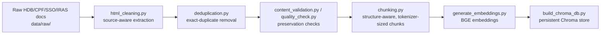
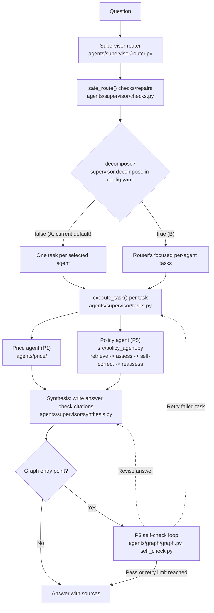

# End-to-end pipeline map

This is a map, not a manual: it traces one question (and the data behind it)
across every phase and links out to the doc that owns the detail. When a
phase's behavior changes, update that phase's own doc; only update this one
if a stage is added, removed, or its entry point moves.

Checked against the local code and configuration on **31 October 2026**.
The current configuration uses baseline routing (`supervisor.decompose: false`),
real policy retrieval with `policy_top_k: 10`, price approach A and one graph
self-check retry with LLM review enabled. A/B evaluation overrides decomposition
per execution. Read [config.yaml](../config.yaml) for the applied local settings.

## 1. From raw documents to a queryable index (P4 → P5 infra)

Runs ahead of time, not per question. Only needed again if the source
documents or chunking/embedding settings change.

| Stage | Code | Docs |
| --- | --- | --- |
| Clean, dedupe, validate, chunk | [scripts/html_cleaning.py](../scripts/html_cleaning.py), [deduplication.py](../scripts/deduplication.py), [content_validation.py](../scripts/content_validation.py), [quality_check.py](../scripts/quality_check.py), [chunking.py](../scripts/chunking.py) | Handoff fields and responsibilities: [data_prep_policy_handoff.md](data_prep_policy_handoff.md) |
| Embed and build the vector store | [scripts/generate_embeddings.py](../scripts/generate_embeddings.py), [scripts/build_chroma_db.py](../scripts/build_chroma_db.py) | Settings: `data_preparation.*` in [config.yaml](../config.yaml); build commands in [supervisor_guide.md](supervisor_guide.md#agent-configuration-and-integration) |

Output: `data/processed/chunks.jsonl` plus the gitignored, locally-built
`data/embeddings/` and `data/vector_db/`.

The HDB resale price table used by the price agent is prepared separately —
see [the price agent's rebuild steps](../agents/price/README.md#rebuild-the-price-data).

## 2. One question, end to end (P1/P2/P3/P5 at request time)

| Stage | Code | Docs |
| --- | --- | --- |
| Route, check, decompose | [router.py](../agents/supervisor/router.py), [checks.py](../agents/supervisor/checks.py), [tasks.py](../agents/supervisor/tasks.py) | [supervisor_guide.md](supervisor_guide.md) |
| Price facts | [agents/price/](../agents/price/) | [agents/price/README.md](../agents/price/README.md) |
| Policy evidence | [src/policy_agent.py](../src/policy_agent.py), [src/evidence_assessor.py](../src/evidence_assessor.py) | [policy_agent_rag.md](policy_agent_rag.md) |
| Write and check the answer | [synthesis.py](../agents/supervisor/synthesis.py) | [supervisor_guide.md](supervisor_guide.md) |
| Optional: parallel branches + self-check | [agents/graph/graph.py](../agents/graph/graph.py), [self_check.py](../agents/graph/self_check.py) | [supervisor_ablation.md](supervisor_ablation.md) |

Two entry points run this: `agents.supervisor.pipeline.handle_question()`
(no self-check) and `agents.graph.graph.run()` (adds P3's self-check loop).
Both read the same `supervisor.decompose` setting and share the `tasks.py`
helpers, so they select agents and execute tasks identically — the ablation
guide explains how to choose between them.

## 3. Where the answer goes, and what gets recorded

| What | Where | Docs |
| --- | --- | --- |
| Demo UI | `streamlit run ui/app.py` | [ui/README.md](../ui/README.md) |
| Per-run token/cost history (CSV) | `logs/usage/` | [usage_logging.md](usage_logging.md) |
| Routing/answer evaluation runs | `evaluation/results/`, `evaluation/answers/` | [supervisor_guide.md §4](supervisor_guide.md#4-evaluate-label-run-grade-score) |
| Paired A/B decomposition evaluation | `evaluation/ablation/` | [supervisor_ablation.md](supervisor_ablation.md) |
| Per-stage diagnosis and compact Excel review, optionally judge-assisted | A chosen review directory under `evaluation/ablation/<run>/` | [stage_evaluation.md](stage_evaluation.md) |
| LLM-as-judge bias/agreement checks | `evaluation/agentic/judge_swap_check.json`, `human_label_sample.csv` | [llm_judge_validation.md](llm_judge_validation.md) |

## 4. Setup and conventions

New to the repo, or just need the commands to run any of the above? See
[MAINTENANCE.md](MAINTENANCE.md). It is not part of this flow — it's how you
get an environment that can run every stage above.

## 5. What this map leaves out

Historical/background docs that don't describe current behavior:
[price_agent_synthesis_review.md](price_agent_synthesis_review.md) (an early
P1 review of synthesis rules), [data_prep_policy_handoff.md](data_prep_policy_handoff.md)'s
original scope split, and [CHANGELOG.md](CHANGELOG.md) (why things changed
over time, not how the system works today).
