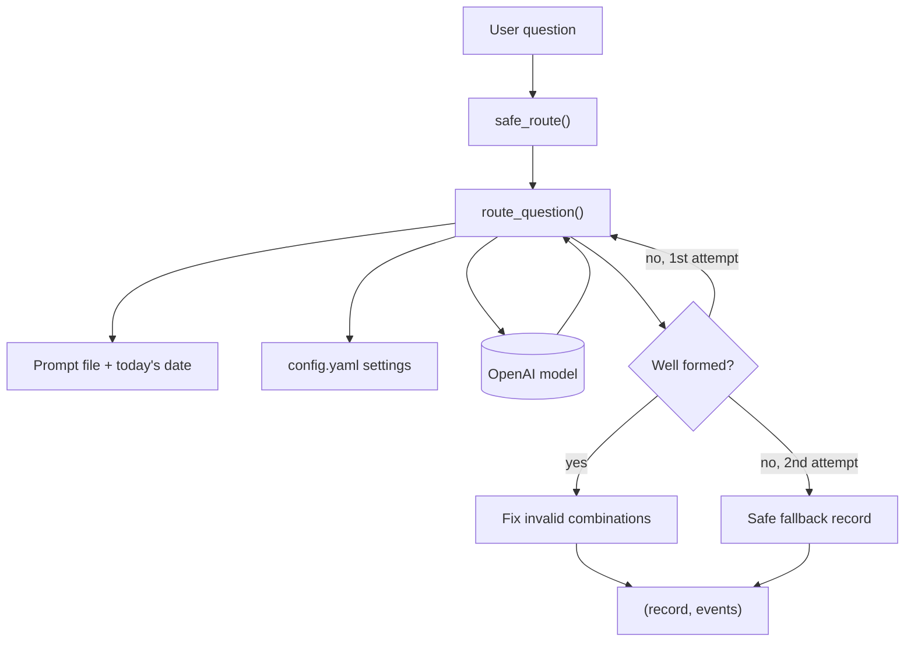

# P2 Supervisor: Code Guide

Owner: P2 (supervisor and synthesis integration)

What the supervisor code does, how to run it, and how each part works.
For *why* the rules are what they are, see `Docs/routing_spec.md`.
For what the supervisor exchanges with other agents, see
`Docs/p2_supervisor_contract.md`.

---

## 1. What it does

The supervisor reads a user's question and decides where to look for the
answer. It does **not** answer the question. It returns a **routing record**:

```json
{
  "route": "both",
  "false_belief": true,
  "answerable": true,
  "reason": "Assumes singles cannot buy resale flats, which is false (R3); the price part comes from resale transactions."
}
```

| Field | Values | Meaning |
| ----- | ------ | ------- |
| `route` | `price` / `policy` / `both` / `none` | Which agents to call |
| `false_belief` | `true` / `false` | The question rests on something untrue (the router's suspicion; synthesis checks it against evidence) |
| `answerable` | `true` / `false` | Whether the actual question can be answered from our sources |
| `reason` | one sentence | The deciding factor, citing a rule (R1 to R5) where one applies |

---

## 2. Files

```
agents/supervisor/
├── prompts/
│   └── supervisor_v1.md   the instructions the model reads every call
├── router.py              sends the prompt and question to the model
└── checks.py              safety layer: retries, fixes, fallback
tests/
├── test_supervisor_router.py
└── test_supervisor_checks.py
config.yaml                model and limits (section "llm")
.env                       API key (local only, never committed)
```

**Other code should call `safe_route()` from `checks.py`, never
`route_question()` directly.** `safe_route()` applies every safety check.

---

## 3. How a question flows through



1. `safe_route()` calls `route_question()`.
2. `route_question()` reads the prompt and settings, calls the model with
   structured output, and turns the reply into a dictionary.
3. `safe_route()` checks the record. If it is unusable, it tries once more;
   if that also fails, it returns the safe fallback.
4. A usable record has its contradictions fixed (routing spec, section 4).
5. It returns the record plus a list of **events** describing every retry
   and fix, for the step log.

---

## 4. How to run it

All commands run from the project folder, with the environment active:

```bash
source .venv/bin/activate
```

**Route one question (makes one real API call):**

```bash
python -m agents.supervisor.router "Can I use CPF for a resale flat?"
```

**Use it from other code:**

```python
from agents.supervisor.checks import safe_route

record, events = safe_route("Can I use CPF for a resale flat?")
record["route"]   # "policy"
events            # [] when nothing needed fixing
```

**Run the tests (no API calls, no cost):**

```bash
python -m pytest tests/ -v
```

---

## 5. Settings (`config.yaml`)

```yaml
llm:
  model: "gpt-5.4-2026-03-05"
  temperature: 0
  seed: 42
  timeout_seconds: 30
  max_output_tokens: null
```

| Setting | What it does | Notes |
| ------- | ------------ | ----- |
| `model` | Which model is called | Team standard. Dated snapshot so the model cannot change between runs. Must be the same for V0, V1 and V2 |
| `temperature` | How varied replies are; 0 = most consistent | Set to `null` if a model rejects it |
| `seed` | Fixed starting point for randomness | Helps reruns match; not a guarantee |
| `timeout_seconds` | Give up on a call after this long | A timeout is retried once |
| `max_output_tokens` | Cap on reply length | Off (`null`) until tested; too low can cut off the reply |

A setting set to `null` is simply not sent to the API.

The API key is read from `.env`, under `OPENAI_API_KEY` (or `LLM_API_KEY`
as a fallback). See `.env.example` for the name.

---

## 6. `router.py`

### `route_question(question, client=None, today=None) -> dict`

Classifies one question and returns the routing record.

- `client`: optional. Pass a fake client in tests to avoid real API calls.
- `today`: optional date string (`"2026-10-18"`). Defaults to today. The
  prompt needs it to judge what counts as "the future" (rule R4).

### Helpers

| Function | Job |
| -------- | --- |
| `load_settings()` | Reads the `llm` section of `config.yaml`; stops with a clear error if no model is set |
| `load_prompt(today)` | Reads the prompt file and fills in `{today}` |
| `make_client(timeout)` | Reads the key from `.env` and creates the OpenAI client |

### Design notes

- **Structured output** (`ROUTING_SCHEMA`, `"strict": True`): the API only
  allows replies that match the four fields and their allowed values, so
  the model cannot invent a route such as `"myth"`.
- **`.replace("{today}", ...)`, not `.format()`:** the prompt contains JSON
  examples full of curly braces, which `.format()` would treat as
  placeholders and crash on.
- **`PROJECT_ROOT`** is worked out from the file's own location, so the
  router finds `config.yaml`, `.env` and the prompt from any folder.
- **`RouterReplyError`** is raised when the model replies with no content
  (for example a refusal), so the problem has a clear name.

---

## 7. `checks.py`

### `safe_route(question, router=route_question, **router_kwargs) -> (record, events)`

The function the rest of the system calls.

- `router`: optional. Pass a fake router in tests.
- `**router_kwargs`: passed through to the router (e.g. `today=...`).
- Returns the **record** (always exactly the four contract fields) and a
  list of **events**.

### Events

Each event is a dictionary for the step log:

```python
{"code": "invalid_combo", "attempt": 1,
 "detail": "route none with false_belief true: route set to policy"}
```

| Code | Meaning |
| ---- | ------- |
| `malformed_output` | That attempt's reply was unusable (bad JSON, missing field, wrong value, empty reason, refusal, or a temporary API failure) |
| `invalid_combo` | The reply was usable but contradictory, and was fixed |

Counting events across a test run shows how often the checks had to step in.

### Invalid combinations (routing spec, section 4)

| Combination | Fix |
| ----------- | --- |
| `route = none` with `false_belief = true` | `route` becomes `policy` (a myth needs evidence) |
| `route = none` with `answerable = true` | `answerable` becomes `false` (nothing to answer from) |

The myth rule is checked **first**. A record with both problems becomes
`policy` and stays answerable.

### Which errors are retried

| Retried once (temporary or a bad reply) | Not retried: stops the program (setup problem) |
| --------------------------------------- | ---------------------------------------------- |
| `JSONDecodeError`: reply not valid JSON | `AuthenticationError` (401): wrong or missing API key |
| `RouterReplyError`: no content, e.g. a refusal | `NotFoundError` (404): wrong model name |
| `APIConnectionError`: network problem or timeout | `BadRequestError` (400): unsupported setting, e.g. temperature |
| `RateLimitError` (429): too many requests | `PermissionDeniedError` (403): key cannot use this model |
| `InternalServerError` (5xx): OpenAI server error | `ValueError`: missing model in `config.yaml`; any other bug |

**Principle:** retry what is temporary; stop on what is permanent. A silent
fallback on a setup problem would turn every question into "can't help"
without anyone noticing.

### Safe fallback

Used when both attempts fail:

```python
{"route": "none", "false_belief": False, "answerable": False,
 "reason": "Router output could not be read; using the safest fallback."}
```

---

## 8. Tests

Every test uses a fake router or fake client, so tests are free and run in
under a second.

| File | What it proves |
| ---- | -------------- |
| `test_supervisor_router.py` | A reply becomes a dictionary; a refusal raises `RouterReplyError` |
| `test_supervisor_checks.py` | Valid records pass unchanged; both contradictions are fixed, in the right order; bad replies are retried once, then fall back; temporary API errors are retried; setup errors (wrong key, wrong model, bad setting, missing config) stop the program |

Run them after any change to `router.py` or `checks.py`. A failing test
means a rule from the routing spec has been broken.

---

## 9. Changing the prompt

1. Copy the current prompt to a new version, e.g. `supervisor_v2.md`.
   Never overwrite an old version: each one is evidence of how tuning went.
2. Edit the new file.
3. Point `PROMPT_FILE` in `router.py` at the new file.
4. Rerun the practice questions and record the score for each version.

Keep the prompt in step with `Docs/routing_spec.md`: change the spec first,
then the prompt.

**The six examples in the prompt must never appear in the practice or held
out question sets**, or the router would be scored on answers it has
already been shown.

---

## 10. Troubleshooting

| Message | Cause | Fix |
| ------- | ----- | --- |
| `No model set. Add llm.model to config.yaml.` | `config.yaml` missing the model | Add the `llm.model` line |
| `No API key found` | `.env` missing or empty | Add `OPENAI_API_KEY=...` to `.env` |
| `AuthenticationError` | Key wrong or revoked | Create a new key in your OpenAI account |
| `NotFoundError` | Model name misspelled or retired | Check the name against the models list |
| `BadRequestError` mentioning temperature or seed | Model does not support that setting | Set it to `null` in `config.yaml` |
| `ModuleNotFoundError: No module named 'agents'` | Run from the wrong folder | `cd` into the project folder first |

---

## 11. Known limitations

- **The router cannot see the sources.** It judges false beliefs and future
  announcements from the model's own knowledge, which may be out of date.
  The flag only routes the question to the evidence; synthesis must confirm
  against the retrieved pages (routing spec, section 7).
- **`reason` is written after the decision.** It is the model's stated
  justification, not a record of how it decided. Putting `reason` first in
  the schema is a planned experiment for tuning.
- **Same settings are not a guarantee of identical output.** Even with
  temperature 0, a seed and a pinned model, reruns can differ slightly, so
  scored runs should be repeated.

---

## 12. History

| Version | Change |
| ------- | ------ |
| Phase C | Router and prompt v1; runs live on `gpt-5.4-2026-03-05` |
| Phase D | Safety checks, timeout, optional reply cap; retries limited to temporary errors; refusals handled; 17 tests |
