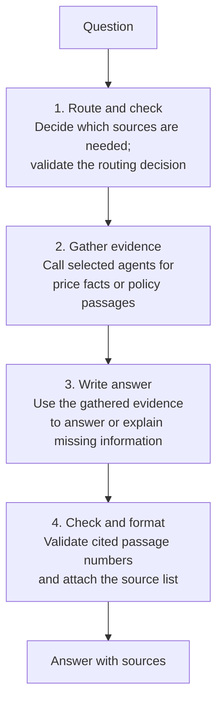
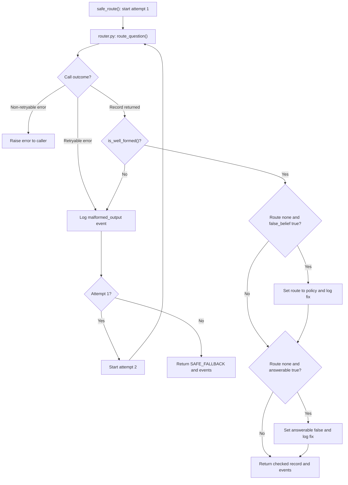
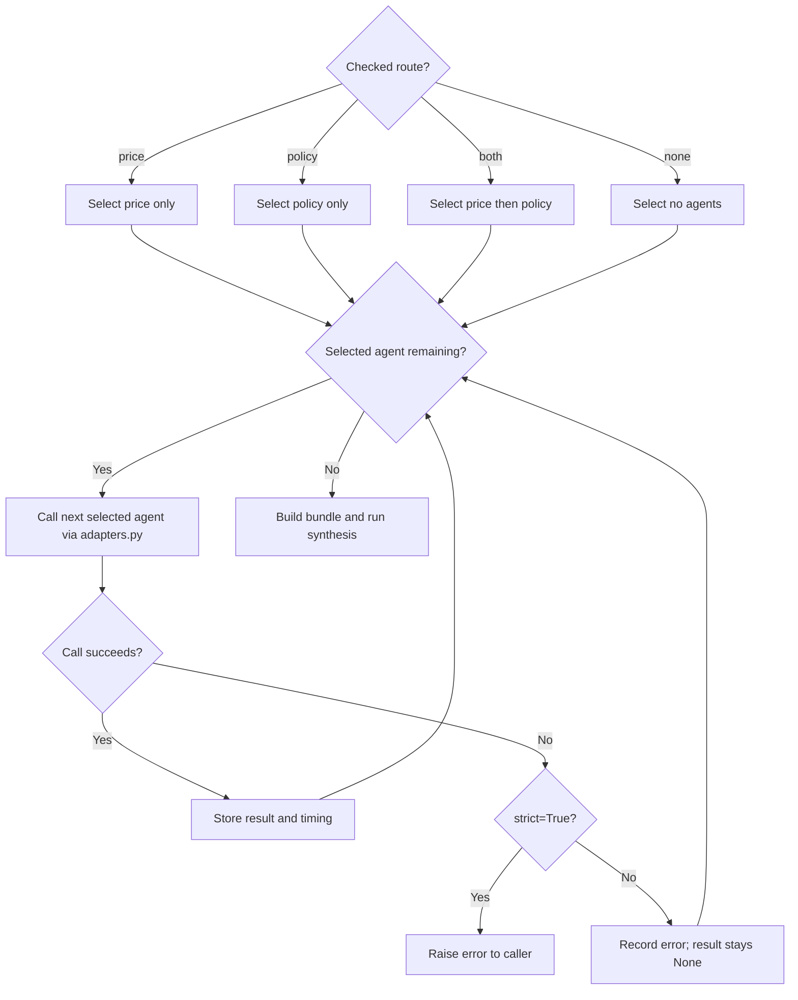
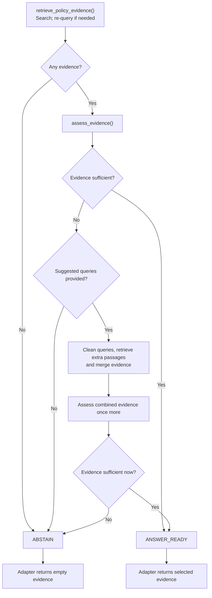
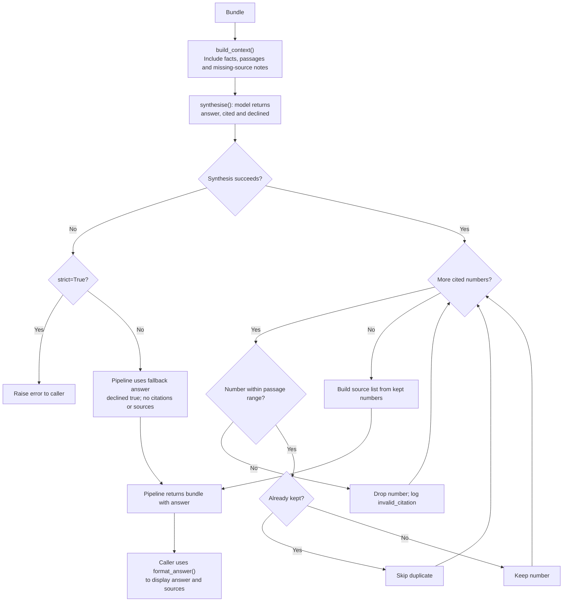

# Supervisor code guide

The supervisor takes a question, selects the evidence it needs, and writes an answer with sources.

Start with `handle_question()` in [pipeline.py](../agents/supervisor/pipeline.py). The routing and synthesis prompts define the decision rules; the tables below explain the returned fields.

## 1. High-level flow



The route selects price, policy, both or neither. For `both`, price runs first, then policy; for `none`, evidence gathering is skipped. Both price and policy now use real evidence.

### Code behind each stage

[`pipeline.py`](../agents/supervisor/pipeline.py): `handle_question()` runs the whole flow, collects the bundle and logs timing/errors.

| Stage | Scripts and key functions |
| --- | --- |
| **1. Route and check** | [router.py](../agents/supervisor/router.py): `route_question()` classifies; [checks.py](../agents/supervisor/checks.py): `safe_route()` validates, retries and repairs using `is_well_formed()` and `fix_combinations()` |
| **2. Gather evidence** | [adapters.py](../agents/supervisor/adapters.py): `get_price_agent()` / `get_policy_agent()` select implementations; `price_real()` / `policy_real()` provide results. Price calls `agents.price.run_price_agent()`. Policy calls [policy_agent.py](../src/policy_agent.py): `run_policy_agent()`, which uses `retrieve_policy_evidence()` and `assess_evidence()` |
| **3. Write answer** | [synthesis.py](../agents/supervisor/synthesis.py): `build_context()` prepares evidence; `synthesise()` asks the model to write the answer |
| **4. Check and format** | [synthesis.py](../agents/supervisor/synthesis.py): `check_citations()` validates passage numbers; `synthesise()` builds sources; `format_answer()` formats the display |

Token tracking runs alongside the flow: `record_usage()` in `router.py` logs routing/synthesis tokens in `bundle["usage"]`.

For example, **“Can I use CPF for a resale flat?”** should route to `policy`. The policy agent searches for relevant passages. Synthesis receives those passages and writes the answer. Code attaches the sources using passage metadata.

Routing and synthesis each call the model. The real price agent calls the model to extract filters (or write SQL); the policy agent can call the model to assess evidence. Routing retries can add calls too.

### Detailed flow: routing checks

In `checks.py`, `safe_route()` allows two router attempts. Diamonds show conditions; labelled arrows show the if/else outcomes.



### Detailed flow: agent selection and execution

In `pipeline.py`, `AGENTS_FOR_ROUTE` creates an ordered list of agents. Each call goes through the same success/error branch.



Currently, the price call is `price_real()` and the policy call is `policy_real()`. A policy abstention is a successful call with empty evidence, so it follows the success branch above.

### Detailed flow: policy evidence decisions

`adapters.policy_real()` calls `src/policy_agent.py: run_policy_agent()` with dense retrieval and LLM assessment enabled. The chart shows that configured path.



The self-correction stage happens at most once, although it can search several suggested queries. Retrieval/assessment exceptions follow the pipeline's agent-error branch.

### Detailed flow: synthesis and citations

In `synthesis.py`, missing evidence is described in model context. Answering or declining is a model decision guided by the prompt, rather than a Python if/else check on evidence alone.



Citation filtering changes the `cited` list and sources, not citation markers inside answer prose. The pipeline returns a bundle; its CLI calls `format_answer()` for display.

## 2. What each file does

All files below are in `agents/supervisor/`.

| File | Main function | Purpose |
| --- | --- | --- |
| [pipeline.py](../agents/supervisor/pipeline.py) | `handle_question()` | Runs the stages and returns the results, errors, timing and token usage |
| [router.py](../agents/supervisor/router.py) | `route_question()` | Reads the prompt/settings and asks the model to classify the question |
| [checks.py](../agents/supervisor/checks.py) | `safe_route()` | Validates routing output, retries failures and repairs known contradictions |
| [adapters.py](../agents/supervisor/adapters.py) | `get_price_agent()`, `get_policy_agent()` | Selects stub/real agents and adapts their outputs for the pipeline |
| [synthesis.py](../agents/supervisor/synthesis.py) | `synthesise()`, `format_answer()` | Writes the answer, checks citation numbers and formats sources |
| [evaluate.py](../agents/supervisor/evaluate.py) | `run()`, `score()` | Compares routing predictions with labelled questions |
| [score_answers.py](../agents/supervisor/score_answers.py) | `answer_all()`, `score_sheet()` | Generates answer grading sheets and scores reviewed grades |

Call `handle_question()` for a complete answer, or `safe_route()` for routing with checks. The router CLI calls `route_question()` directly and is useful for inspecting one raw classification.

### Routing fields and safety checks

The router returns four fields:

| Field | Meaning |
| --- | --- |
| `route` | `price`, `policy`, `both` or `none` |
| `false_belief` | The question may contain an incorrect premise; evidence must confirm it |
| `answerable` | Whether the actual question can be answered from the available sources |
| `reason` | The model's explanation for its decision |

A grant amount needs policy evidence. A historical resale price needs transaction evidence. An unanswerable question can still route to an agent for related context.

`safe_route()` follows this sequence:

1. Call the router.
2. If a retryable error occurs or the record is malformed, try once more. After two unsuccessful attempts, return `SAFE_FALLBACK`: `none`, no false-belief flag, not answerable.
3. Repair known contradictions and return `(record, events)`.

| Contradiction | Repair |
| --- | --- |
| `route=none`, `false_belief=True` | Set `route=policy` so evidence can be checked |
| `route=none`, `answerable=True` | Set `answerable=False` |

The first repair runs before the second. If both contradictions occur, the result is `policy` and remains answerable.

Retries cover malformed replies, refusals, connection/timeouts, rate limits and server errors. Setup errors such as a wrong key or invalid model propagate to the caller. Events record malformed attempts and repairs.

### Agent status and policy integration

Current [config.yaml](../config.yaml) settings:

```yaml
agents:
  price: real
  policy: real
  policy_top_k: 10
```

- **Price:** `price_real()` calls `run_price_agent()` in [agents/price/__init__.py](../agents/price/__init__.py). The default approach A extracts town, flat type and period with the model, then calculates statistics from `data/cleaned/hdb_resale_prices.csv.gz`. `price_agent.approach: B` selects the SQL alternative. See the [price guide](../agents/price/README.md).
- **Policy:** calls `run_policy_agent()` in [src/policy_agent.py](../src/policy_agent.py), with keyword + embedding search, an automatic re-query when needed, and an LLM evidence check with one possible self-correction pass.

The policy adapter takes the agent's nested `retrieval` result and exposes `evidence` at the top level. It also retains `decision`, `reason` and `trace` in `bundle["policy_result"]`. If the decision is not `ANSWER_READY`, it empties the evidence so synthesis receives no policy passages.

A real policy run needs the chunk corpus, embeddings and local Chroma store. For a fresh clone or changed corpus, build these from the project root:

```bash
python -m scripts.generate_embeddings
python -m scripts.build_chroma_db
```

These read `data_preparation.embedding` and `data_preparation.vector_store` settings. Embeddings and the database are gitignored and must be generated locally. Reuse them for routine questions; rebuild them when the corpus changes. Embedding generation may download the configured model.

### The bundle, errors and token tracking

A **bundle** is the dictionary returned by `handle_question()`:

| Key | Contents |
| --- | --- |
| `question`, `today` | Original question and date shared by the stages |
| `routing` | Checked routing decision |
| `price_result`, `policy_result` | Agent output, or `None` if skipped/failed |
| `agent_errors` | Failures keyed by agent name |
| `steps` | Stage timings, events, errors and stub flags |
| `usage` | Router/synthesis input and output token counts per returned model response |
| `answer` | Answer text, `declined`, valid `cited` numbers, `sources` and citation events |

With default `strict=False`, agent errors are recorded and processing continues; synthesis errors produce a fallback answer. With `strict=True`, those errors are raised. The pipeline CLI uses strict mode. Routing errors that escape `safe_route()` propagate in either mode.

Token tracking uses the same list through routing and synthesis:

```text
pipeline: usage = []
    -> router: record_usage(usage, "router", response)
    -> synthesis: record_usage(usage, "synthesis", response)
    -> returned as bundle["usage"]
    -> score_answers.py sums tokens per question for its CSV
```

`record_usage()` lives in `router.py`. Missing usage metadata produces `None` counts. These totals do not calculate money spent and do not include the policy agent's assessor calls. The policy agent returns separate `assessor_usage`, which the current adapter does not forward.

### What the citation check guarantees

Synthesis receives numbered passages and returns `answer`, `cited` and `declined`. Code removes invalid/duplicate numbers from `cited` and builds the source list from the corresponding passage metadata.

This checks that citation numbers refer to supplied passages. It does not verify claim support, remove invalid markers inside answer text, or prevent invented links in model-written prose. Answer rules are mainly prompt instructions.

## 3. Run it

Run from the project root with dependencies installed. Model calls require `OPENAI_API_KEY` or `LLM_API_KEY` in your local `.env`.

```bash
source .venv/bin/activate

# Local supervisor tests using fakes; no model calls.
python -m pytest tests/test_supervisor_*.py -q

# Inspect one routing decision.
python -m agents.supervisor.router "Can I use CPF for a resale flat?"

# Full pipeline: routing, selected agents, synthesis.
python -m agents.supervisor.pipeline "Can I use CPF for a resale flat?"
```

From Python:

```python
from agents.supervisor.pipeline import handle_question
from agents.supervisor.synthesis import format_answer

bundle = handle_question("Can I use CPF for a resale flat?")
print(format_answer(bundle["answer"]))
print(bundle["usage"])
```

Model settings live under `llm` in `config.yaml`. Optional request settings set to `null` are omitted. See [MAINTENANCE.md](MAINTENANCE.md) for environment setup and the team's Git workflow.

## 4. Evaluate: label, run, grade, score

### Label questions

Add rows to [practice_routing.csv](../data/labels/practice_routing.csv) for tuning. Reserve [routing_labels.csv](../data/labels/routing_labels.csv) for held-out evaluation.

Each row needs `question_id`, `question`, `route`, `false_belief` and `answerable`. Follow the existing format for `kind`, `rationale` and `labelled_by`. Use stable IDs such as `PR_P2_05`, and `TRUE`/`FALSE` labels.

Label the actual question: a forecast may be unanswerable even when historical facts provide useful context. Keep prompt examples out of practice and held-out sets.

### Check routing

```bash
python -m agents.supervisor.evaluate data/labels/practice_routing.csv
```

This makes live router calls and reports field accuracy, all-three accuracy, myth detection, false alarms, repairs/retries, a route confusion table and misses. Results go to `evaluation/results/`.

### Check final answers

1. Generate answers using the current pipeline:

   ```bash
   python -m agents.supervisor.score_answers run data/labels/practice_routing.csv
   ```

2. Open the printed CSV path under `evaluation/answers/`. Read each answer and review `grade_declined`, which is pre-filled from the model's own claim. Fill `grade_myth_accepted` for false-belief questions; leave `n/a` for other rows. Extra columns such as `grader_notes` are allowed.

3. Save the reviewed file, then score it:

   ```bash
   python -m agents.supervisor.score_answers score evaluation/answers/<reviewed-file>.csv
   ```

| Metric | Calculation | Better |
| --- | --- | --- |
| Myth acceptance | Myth questions whose answers accept the false premise / all myth questions | Lower |
| Honesty | Unanswerable questions whose answers decline / all unanswerable questions | Higher |
| Over-refusal | Answerable questions whose answers decline / all answerable questions | Lower |

Required blank grades stop scoring. Pre-filled grades still need human review. Scoring a reviewed sheet makes no model calls; generating answers does. Both agents currently use real evidence; if either is switched to a stub, treat that run as a plumbing check.

If scores worsen, inspect routing, retrieved evidence, agent failures, synthesis and labels before deciding what to change. Keep saved runs for comparison.

## 5. Change a prompt

| Prompt | Used by |
| --- | --- |
| [supervisor_v1.md](../agents/supervisor/prompts/supervisor_v1.md) | Router: rules R1–R5 and routing examples |
| [synthesis_v1.md](../agents/supervisor/prompts/synthesis_v1.md) | Synthesis: answer rules A1–A8 |

1. Decide which routing or answer rule needs to change and update its explanation alongside the prompt.
2. Copy the prompt to a new version, edit it, and update `PROMPT_FILE` in `router.py` or `synthesis.py`. Keep old versions for comparison.
3. If reply fields change, update the JSON schema, prompt, consuming code and tests together. Wording changes alone do not require a schema change.
4. Run supervisor tests, then the relevant live evaluation. Tests with fakes do not measure prompt quality.

Prompts are read at call time and `{today}` is replaced with the shared date. Code enforces the two routing repairs and citation-number checks; other routing/answer rules depend mainly on the model following instructions.

## 6. Troubleshooting

| Problem | Check |
| --- | --- |
| `No model set` | Add `llm.model` in `config.yaml` |
| `No API key found` / authentication error | Check the key in local `.env` |
| Unsupported temperature/seed | Set the optional setting to `null` |
| `No module named 'agents'` | Run from the project root |
| Price data or import failure | Install dependencies and check `price_agent.cleaned_data`; rebuild with `python -m scripts.clean_prices` if the original raw CSV is available |
| Policy import or retrieval failure | Check dependencies, policy modules, embeddings and Chroma store |
| `Ungraded row` | Complete the required grade columns in that row |

The router cannot inspect the corpus when it flags a false belief. Treat that flag as a suspicion; retrieved evidence must support any correction. Real policy retrieval is connected, but a successful run alone does not establish answer accuracy.
