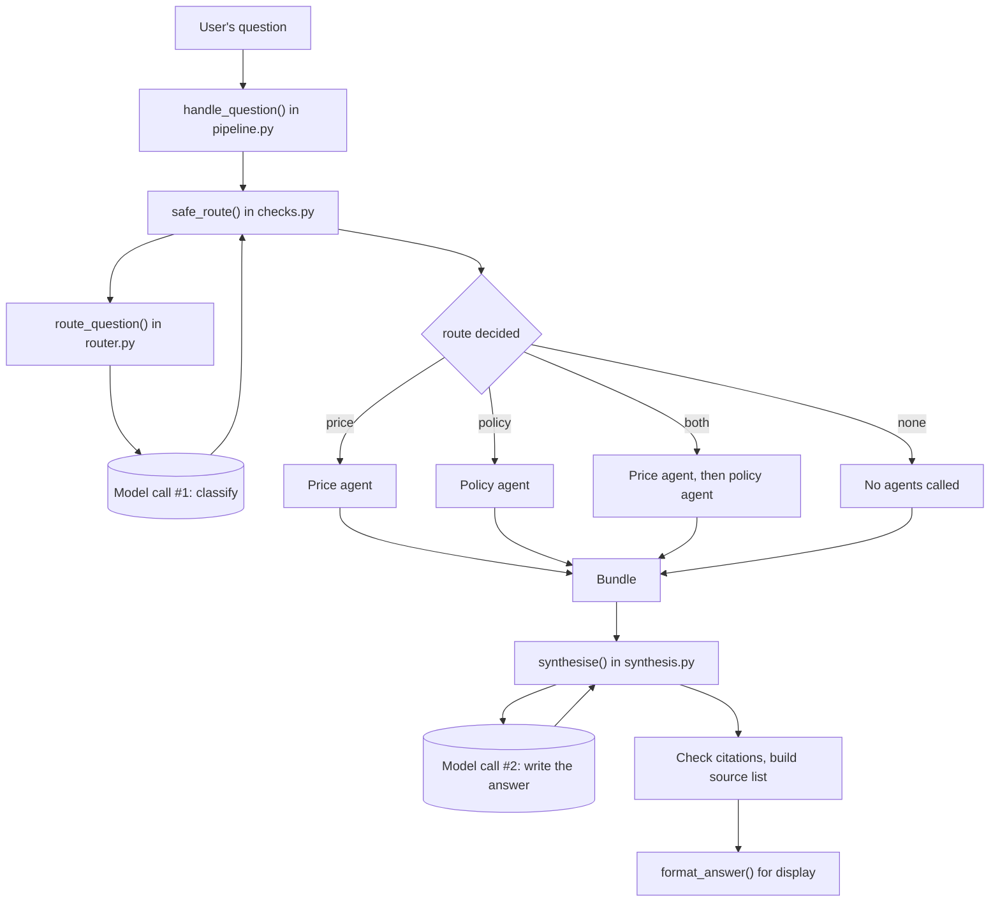

# The Supervisor, Explained Simply

This is a plain-English walkthrough of everything in `agents/supervisor/`.
It's written so you (or anyone else) can come back after a break and
remember how the pieces fit, without re-reading all the code.

For the *rules* behind the decisions (why a question is "price" vs
"policy"), see `Docs/routing_spec.md`. This doc is about the *code*: what
each file does, how they call each other, and how to run/troubleshoot it.

---

## 1. The big picture

Think of the supervisor as a **call center dispatcher**, not the person who
answers the phone.

- A question comes in: *"Can I use CPF for a resale flat?"*
- The dispatcher (the **router**) doesn't answer it. It just decides: *"this
  needs the policy team."*
- The policy team (an **agent**) goes and finds the relevant rule passages.
- A **writer** (synthesis) takes those passages and the original question
  and drafts a reply, with sources attached.
- A **manager** (the pipeline) oversees the whole call: it starts the
  dispatcher, hands off to the right team(s), times everything, and makes
  sure that if something breaks mid-call, the customer still gets a
  reasonable answer instead of silence.

There are two kinds of evidence this system can hand the writer:
- **Policy facts** — rules, eligibility, grant amounts, from HDB/CPF pages.
- **Price facts** — what flats actually sold for, from resale transaction
  records.

The router decides which of these (if any) a question needs.

---

## 2. The whole flow, in order



Two things actually call the AI model: **classifying the question**
(router) and **writing the final answer** (synthesis). Everything else is
plain Python logic wrapped around those two calls — retries, safety
checks, bookkeeping, and formatting.

A **"bundle"** is just a Python dictionary that carries everything
collected so far (the question, the routing decision, whatever the
agents returned, timing info, and eventually the answer). It's the thing
that gets passed from stage to stage.

---

## 3. Walking one question through, start to finish

Question: *"Since singles can't buy resale flats at all, what's the
cheapest 2-room in Yishun?"*

1. **`pipeline.handle_question()`** is called with this question. It
   records today's date (shared by every stage so "recently" means the
   same thing everywhere) and starts a stopwatch.
2. It calls **`checks.safe_route()`**, which calls **`router.route_question()`**.
   This sends the question to the model along with the routing prompt and
   asks for a strict JSON reply. The model comes back with something like:
   ```json
   {"route": "both", "false_belief": true, "answerable": true,
    "reason": "Assumes singles can't buy resale flats, which is false..."}
   ```
3. `safe_route()` checks that reply is well-formed (right fields, right
   types, non-empty reason) and that it doesn't contain a contradiction
   (like "route: none" plus "false_belief: true"). If it's broken, it
   retries once; if it's still broken, it falls back to a safe
   "can't help with this" record instead of crashing or guessing.
4. Because `route = "both"`, the pipeline calls **both** agents, in a
   fixed order: price first, then policy (see `AGENTS_FOR_ROUTE` in
   `pipeline.py`).
   - The **price agent** (currently a stub — see below) returns sample
     numbers: median/min/max price, how many deals, what period.
   - The **policy agent** (currently a stub) returns a fake policy
     passage. A real one would search the indexed HDB/CPF documents and
     return the actual passages about singles buying resale flats.
5. Everything collected so far — the question, the routing decision, both
   agents' results, any errors, and a running log of how long each step
   took — goes into the **bundle**.
6. The bundle is handed to **`synthesis.synthesise()`**. This builds one
   big text block containing the routing flags, the price numbers, and
   the policy passages (each numbered `[1]`, `[2]`, ...), then sends that
   block plus the synthesis prompt to the model.
7. The model replies with the answer text, which passage numbers it used
   (`cited`), and whether it's declining to answer (`declined`).
8. The code — **not the model** — checks that every cited number actually
   points at a real passage (removing anything invalid or duplicated),
   and builds the **source list** (titles, links, dates) directly from the
   passage data. This is deliberate: the model can get a citation number
   wrong, but it can never *invent* a fake link, because the code builds
   links from data it already has, not from what the model writes.
9. **`format_answer()`** glues the answer text and the source list
   together for display.

If you ran this from the command line, you'd see the final answer, the
routing decision, and a timing breakdown of every step.

---

## 4. Each file, explained

### `pipeline.py` — the manager

**What it's for:** runs one question through the whole process and
returns the bundle. This is the one function most other code should call:
`handle_question(question)`.

**Key things to know:**
- `AGENTS_FOR_ROUTE` is a lookup table that says which agents to call for
  each routing decision, and in what order. `"both"` always means price
  then policy.
- It keeps a `usage` list going through the whole run — one entry per
  model call, recording input/output token counts. This is how the system
  tracks what each answer costs.
- `strict=False` (the default) means: if an agent blows up, don't crash —
  record the error and keep going with whatever evidence you do have. If
  synthesis itself fails, fall back to a generic "sorry, couldn't put
  together an answer" message rather than showing the user an error.
  `strict=True` (used when you run the file directly from the terminal)
  re-raises everything, which is more useful while you're actively
  debugging.
- Routing failures are the one thing that *always* propagate, even in
  non-strict mode — if routing itself can't tell you anything, there's
  nothing sensible to fall back to.
- Run it directly from the terminal:
  ```bash
  python -m agents.supervisor.pipeline "Can I use CPF for a resale flat?"
  ```

### `router.py` — the dispatcher

**What it's for:** turns a raw question into the four-field routing
decision (`route`, `false_belief`, `answerable`, `reason`) by asking the
model, with "structured output" so the model is *forced* to reply in
exactly that shape (it literally cannot invent a fifth route).

**Key things to know:**
- `load_settings()` reads the model name, temperature, etc. from
  `config.yaml` — never hard-coded, so swapping models is a config change,
  not a code change.
- `load_prompt(today)` reads the prompt template file and stamps in
  today's date, so the model knows what "the future" means when judging a
  question. It uses `.replace()` rather than `.format()` on purpose,
  because the prompt file is full of literal `{` and `}` characters from
  JSON examples that `.format()` would misread as placeholders.
- `make_client()` reads the API key out of `.env` and builds the OpenAI
  client. If there's no key, it fails loudly and immediately rather than
  letting you discover it mid-run.
- `record_usage()` is a small shared helper (also used by `synthesis.py`)
  that pulls token counts off a model response and appends them to a
  shared log, if one was passed in.
- `RouterReplyError` is raised specifically when the model technically
  replied but gave no usable content — most commonly, a refusal.
- Run it alone to see just the routing decision:
  ```bash
  python -m agents.supervisor.router "What was the median resale price of a 4-room flat in Tampines in 2024?"
  ```

### `checks.py` — the safety net around the dispatcher

**What it's for:** everything that keeps a flaky or wrong model reply from
breaking the rest of the system. **Other code should always call
`safe_route()`, never `route_question()` directly** — this is where the
actual safety logic lives.

**Key things to know:**
- `is_well_formed()` checks the reply has all four required fields, the
  right types, and a non-empty reason.
- `fix_combinations()` repairs two known contradictions automatically:
  - `route: none` + `false_belief: true` → forced to `route: policy`,
    because correcting a false belief always needs evidence.
  - `route: none` + `answerable: true` → forced to `answerable: false`,
    because nothing was looked up, so there's nothing to answer from.
- `safe_route()` tries the router, and if the reply is broken (bad JSON,
  missing fields, or a retryable API error), tries **one more time**. If
  both attempts fail, it returns `SAFE_FALLBACK` — a safe "can't help"
  record — rather than ever crashing the pipeline or silently guessing.
- It only retries things that are *temporary* (bad JSON, a refusal, a
  network blip, a rate limit, OpenAI being briefly down). It deliberately
  does **not** retry permanent setup problems — wrong API key, wrong model
  name, a config mistake — because quietly falling back on those would
  turn every single question into "can't help" without anyone noticing
  something is actually broken.
- Every retry or fix is recorded as an **event** (a small dict with a
  `code` and `detail`), which flows into the step log so you can see,
  across a whole evaluation run, how often the safety net had to step in.

### `adapters.py` — the translators

**What it's for:** a thin layer between the pipeline and whatever the
price/policy agents actually look like, so if an agent's output format
changes, you only update its adapter — not the pipeline or synthesis.

**Key things to know:**
- Right now **both agents are stubs** — `price_stub()` always returns the
  same fake numbers, `policy_stub()` always returns the same fake passage,
  both clearly marked with `"stub": True`. This lets you build and test
  the whole pipeline before the real price/policy logic exists.
- `price_real()` currently just raises `NotImplementedError` — there's no
  real price agent wired in yet.
- `policy_real()` expects a real retriever module at `src/policy_retriever.py`
  (built by a teammate). If that file isn't present, it raises a clear
  error telling you to either merge it or switch back to the stub.
- `get_price_agent()` / `get_policy_agent()` read `config.yaml`'s `agents`
  section to decide stub vs. real — so switching from fake to real data is
  a one-line config change, not a code change.

### `synthesis.py` — the writer

**What it's for:** turns the bundle into the actual answer text, with a
trustworthy source list.

**Key things to know:**
- `build_context()` writes everything the model is allowed to use into one
  plain-text block: the routing flags, the price numbers (if any), and
  every policy passage numbered `[1]`, `[2]`, ... in order. If an agent
  failed, that's noted too, so the model knows a source is missing rather
  than silently having less to work with.
- The model's only job is to **write the answer and list which passage
  numbers it used**. It never writes a URL or a title — those always come
  from the code, which is what makes it impossible for the final answer to
  contain a hallucinated link.
- `check_citations()` throws away any cited number that doesn't point to a
  real passage (and drops duplicates), logging an `invalid_citation` event
  for each one it removes. This verifies the *citation markers* are real —
  it does **not** verify that each sentence in the answer is actually
  supported by its citation; that part is still down to the prompt
  instructions, not a hard code check.
- `FALLBACK_ANSWER` is the generic message shown if synthesis itself fails
  (e.g. the model call errors out) — used by `pipeline.py` in non-strict
  mode.
- `format_answer()` is just display glue: answer text, then a "Sources:"
  list built from whatever passed the citation check.

### `evaluate.py` — scoring the dispatcher alone

**What it's for:** checks whether the **router's decisions** (not the
final answers) match a labelled set of questions. This tells you "is the
dispatcher sending calls to the right team," separate from "is the final
answer any good."

**Key things to know:**
- `load_labels()` reads a CSV of questions with their correct `route`,
  `false_belief`, and `answerable` values.
- `run()` routes every question (one model call each) via `safe_route()`.
- `score()` compares predictions to labels field-by-field, and also
  reports myth detection (did it catch the false beliefs?), false alarms
  (did it flag something as a myth that wasn't?), and a confusion matrix
  of routes.
- `save_results()` writes a timestamped CSV to `evaluation/results/`, so
  each prompt version's score is kept for comparison over time.
- Run it with:
  ```bash
  python -m agents.supervisor.evaluate data/labels/practice_routing.csv
  ```

### `score_answers.py` — scoring the finished answers

**What it's for:** `evaluate.py` only checks routing. This script checks
the **actual final answers** for two things a human (or an AI judge) has
to read and decide:
1. **Did it decline honestly** when it should have (or wrongly refuse when
   it shouldn't have)?
2. **Did it go along with a false belief**, for myth questions, instead of
   correcting it?

It's a two-step, run-then-grade process, because those two judgments
can't be computed automatically from the text alone:

**Step 1 — run** (makes two real model calls per question: routing +
synthesis):
```bash
python -m agents.supervisor.score_answers run data/labels/practice_routing.csv
```
This answers every labelled question with the real pipeline and saves a
grading sheet (a CSV) to `evaluation/answers/`. Each row already has the
model's *own claim* about whether it declined, pre-filled as a starting
guess — a human still has to check it.

**Step 2 — grade:** open the saved CSV and fill in (or correct) two
columns by hand:
- `grade_declined` — did the answer actually decline / say "I don't know"?
- `grade_myth_accepted` — for myth questions only: did the answer go along
  with the false belief instead of correcting it?

**Step 3 — score:**
```bash
python -m agents.supervisor.score_answers score evaluation/answers/<your-graded-file>.csv
```
This computes three rates from the graded sheet:
- **Myth acceptance rate** — myth questions answered as if the myth were
  true, out of all myth questions. *Lower is better.*
- **Honesty rate** — unanswerable questions correctly declined, out of all
  unanswerable questions. *Higher is better.*
- **Over-refusal rate** — answerable questions wrongly declined, out of
  all answerable questions. *Lower is better.*

It deliberately **refuses to score an unfinished sheet** — if any grade
cell is still blank, `score_sheet()` raises an error naming the row,
instead of quietly producing a number that's missing data.

One safety note baked in: if the price or policy agent is still set to
`stub` in `config.yaml`, running this prints a loud warning, because the
resulting scores would be testing the *script*, not real answer quality.

---

## 5. Settings, running things, and day-to-day use

### `config.yaml`
All model settings live here — never typed directly into code:
```yaml
llm:
  model: "gpt-5.4-2026-03-05"
  temperature: 0
  seed: 42
  timeout_seconds: 30
  max_output_tokens: null
agents:
  price: "stub"      # or "real"
  policy: "stub"     # or "real"
  policy_top_k: 3
```
Any setting left as `null` simply isn't sent to the API (some models
reject settings like `temperature`).

### `.env`
Holds the real API key, read as `OPENAI_API_KEY` (or `LLM_API_KEY` as a
fallback). Never commit this file — `.env.example` is the template to copy
and fill in.

### Everyday commands (run from the project root, environment activated)
```bash
source .venv/bin/activate

# Tests — no API calls, no cost, fast.
python -m pytest tests/ -q

# Route one question only (one model call).
python -m agents.supervisor.router "Can I use CPF for a resale flat?"

# Full pipeline: route, call agents, write the answer (two model calls).
python -m agents.supervisor.pipeline "Can I use CPF for a resale flat?"

# Score the router against the practice question set.
python -m agents.supervisor.evaluate data/labels/practice_routing.csv

# Score the final answers (run, then grade by hand, then score).
python -m agents.supervisor.score_answers run data/labels/practice_routing.csv
python -m agents.supervisor.score_answers score evaluation/answers/<file>.csv
```

### Repository basics (for anyone new to this project)
- Clone, then build the environment once:
  ```bash
  python -m venv .venv
  source .venv/bin/activate      # Windows: .venv\Scripts\activate
  pip install -r requirements.txt
  ```
- Copy `.env.example` to `.env` and paste in a real API key.
- Activate the environment (`source .venv/bin/activate`) every time you
  open a new terminal.
- Adding a new package? Add its pinned version to `requirements.txt` in
  the same pull request that uses it.
- No direct pushes to `main` — everything goes through a branch + pull
  request. Before committing, run `git status` and double-check `.env`
  and `.venv/` are **not** in the list.
- If a teammate's merged PR touched `requirements.txt`, after you
  `git pull`, also re-run `pip install -r requirements.txt`.

---

## 6. Changing a prompt — and what it does (and doesn't) change in the code

There are exactly two prompt files, one per model call:

| Prompt file | Used by | Sets |
| --- | --- | --- |
| `prompts/supervisor_v1.md` | `router.py` (`PROMPT_FILE`) | the four routing rules R1–R5, the `route`/`false_belief`/`answerable`/`reason` fields, and six worked examples |
| `prompts/synthesis_v1.md` | `synthesis.py` (`PROMPT_FILE`) | the eight answer rules A1–A8 (correct false beliefs first, cite every rule, never invent a price, no financial advice, etc.) and the `answer`/`cited`/`declined` fields |

### How a prompt file actually reaches the model

Both files are plain text read off disk at call time (`PROMPT_FILE.read_text()`),
with `{today}` swapped for the real date, then sent as the `system` message.
There's no caching or build step — **editing the `.md` file is the entire
change**; you don't need to touch `router.py` or `synthesis.py` to reword a
rule, add an example, or change the tone.

The one thing you *can't* loosely edit is the **shape of the reply**. Both
calls use structured output (`ROUTING_SCHEMA` in `router.py`,
`SYNTHESIS_SCHEMA` in `synthesis.py`) — the API enforces that schema
regardless of what the prompt says. If the prompt text and the schema
disagree about what fields exist, the schema wins, and the model's reply
will be forced into the schema's shape. So:

- **Rewording a rule, adding/removing an example, changing instructions
  on tone or style** → prompt file only. No code change needed.
- **Adding, removing, or renaming a field the model must return** (e.g. a
  new `policy_query` field some teammates have discussed) → you must
  change it in **three places together**, or the pieces fall out of sync:
  1. The schema (`ROUTING_SCHEMA` / `SYNTHESIS_SCHEMA`) — or the API will
     reject or strip the field.
  2. The prompt text — so the model actually knows the new field exists
     and what to put in it.
  3. Every bit of code that reads that field by name — for routing that's
     `is_well_formed()` and `fix_combinations()` in `checks.py`, and
     `AGENTS_FOR_ROUTE` / the bundle shape in `pipeline.py`; for synthesis
     that's `check_citations()` and the `sources` list in `synthesis.py`.

### The prompt text and the code's safety net are two different layers

It's easy to assume a rule like "a false belief always gets a lookup" is
something the code enforces everywhere. It isn't — only **two specific
contradictions** are hard-coded as a backstop in `checks.py`
(`fix_combinations()`): `route: none` + `false_belief: true`, and
`route: none` + `answerable: true`. Every other rule (R1, R2, R4, R5 for
routing; all of A1–A8 for synthesis) is enforced purely by **the model
following the prompt's instructions** — there is no deterministic check
behind them. So if you see the model violating, say, A6 (giving financial
advice), the fix is to sharpen the wording in `synthesis_v1.md`, not to
look for a bug in `synthesis.py` — the code has nothing to check there.

The one deterministic check synthesis *does* do, regardless of what the
prompt says, is `check_citations()`: any cited passage number that
doesn't exist gets silently dropped. That's a code-level guarantee, not a
prompt instruction — it holds even if you reword the prompt badly.

### The safe way to change a prompt

1. **Never overwrite a version in place.** Copy it to a new filename first
   (`supervisor_v1.md` → `supervisor_v2.md`, or `synthesis_v1.md` →
   `synthesis_v2.md`). Each old version is kept as a record of what was
   tried and how it scored — overwriting it destroys that history.
2. Edit the **new** file only.
3. Point the relevant `PROMPT_FILE` constant at the new file — in
   `router.py` for routing changes, `synthesis.py` for answer changes.
4. If you touched a routing rule, update `Docs/routing_spec.md` *first*,
   then bring the prompt in line with it — the spec is the source of
   truth for *why* a rule exists; the prompt is just its implementation.
   Same idea for synthesis: the A1–A8 rules in the prompt should match
   section 7 of `Docs/routing_spec.md`.
5. Run the tests (`python -m pytest tests/ -q`) — they use fixtures, not
   the live prompt file, so they won't catch a bad prompt, but they will
   catch anything you accidentally broke in the surrounding code.
6. Measure the actual effect of the change:
   - For a routing prompt change: `python -m agents.supervisor.evaluate data/labels/practice_routing.csv`
   - For a synthesis prompt change, or an end-to-end check:
     `python -m agents.supervisor.score_answers run ...` then `score ...`
7. **Never let a worked example from the prompt leak into the practice or
   held-out question sets.** The six routing examples and any synthesis
   examples you add are things the model has already seen the "answer"
   to — scoring against them would be grading an open-book test as if it
   were closed-book, and the score would be meaningless.

---

## 7. Step by step: writing questions, evaluating routing, scoring answers

This is the full loop you run whenever you add questions or tune a prompt.
It has three parts: write labelled questions, score the router against
them, then score the final answers. Do them in that order — there's no
point grading final answers if the routing underneath them is wrong.

### A. Write up a question (add a row to the labels CSV)

Questions live in `data/labels/practice_routing.csv` (the set you tune
against) and `data/labels/routing_labels.csv` (currently just a header —
meant for a held-out set you never look at while tuning). Each row is one
question, with these columns:

| Column | What goes in it |
| --- | --- |
| `question_id` | `{set}_{author}_{number}`, e.g. `PR_P2_05` — `PR` = practice set, `P2` = whoever wrote it, `05` = a running number. Kind/category is **never** encoded in the ID, so relabelling a question never changes its ID. |
| `question` | The exact question text, quoted if it contains a comma. |
| `kind` | A free-text tag for *your own* use when scanning results — `rules`, `numbers`, `both`, `myth`, `unanswerable`, `out_of_scope`, etc. The code never reads this field; it's there so a human can group misses by pattern. |
| `route` | The correct answer: `price` / `policy` / `both` / `none`. |
| `false_belief` | `TRUE`/`FALSE` — does the question's premise assume something actually untrue? |
| `answerable` | `TRUE`/`FALSE` — can the *actual* question (not just related context) be answered from our sources? |
| `rationale` | One sentence saying why, citing a rule letter if one applies (R1–R5 from `Docs/routing_spec.md`). Write `TRAP:` at the front if the question is deliberately testing a common mistake (see the existing rows for examples) — it makes misses much faster to diagnose later. |
| `labelled_by` | Your initials, for accountability. |

How to decide the three label values — this is the part worth slowing down
for, since a wrong label silently miscalibrates every score downstream:

1. **`route`**: what would actually need to be looked up to answer this?
   A rule or eligibility condition (even one with a dollar amount in it,
   like a grant) is `policy`. A number that comes from actual past sales
   is `price`. Need both kinds of evidence → `both`. Nothing in either
   source is relevant → `none`.
2. **`false_belief`**: is there a factually wrong premise baked into the
   wording? Not every "since..." or "given that..." phrasing is a myth —
   e.g. "Since I'm 36 and single, can I buy a resale flat?" describes the
   *user*, not a rule, so it's `FALSE` even though it has the shape of one
   (see `PR_P2_15`). Only mark `TRUE` when the premise itself is wrong.
3. **`answerable`**: can the literal question be answered — not "is there
   something useful to say." A forecast, a personal-affordability
   question, or something outside the corpus (BTO launch prices) is
   `FALSE`, even though related facts might still be worth routing to as
   context (see R1/R4/R5 and `PR_P2_11`, `PR_P2_17`, `PR_P2_18`).

Two rules that keep the whole evaluation honest:
- **Never reuse a question from the prompt's own worked examples** (the
  six examples in `supervisor_v1.md`, or any you add to `synthesis_v1.md`)
  as a labelled row — the model has already "seen" the answer to those,
  so scoring against them is not a real test.
- Booleans can be written as `TRUE`/`FALSE`, `1`/`0`, or `yes`/`no` —
  `evaluate.to_bool()` accepts all of them case-insensitively — but stay
  consistent with the rest of the file.

That's the entire step. No code changes are needed to add a question —
just add the row and it's picked up the next time you run `evaluate.py` or
`score_answers.py` against that file.

### B. Evaluate the router against your questions

```bash
source .venv/bin/activate
python -m agents.supervisor.evaluate data/labels/practice_routing.csv
```

What happens: it loads every row, calls `safe_route()` once per question
(one real model call each — this costs money), and compares the router's
`route`/`false_belief`/`answerable` against your labels.

What you get back:
- Per-field accuracy (`route`, `false_belief`, `answerable`) and how many
  questions got **all three** right.
- Myths detected vs. false alarms (flagged a myth that wasn't one).
- A count of safety-check events — how often `checks.py` had to retry or
  repair a reply. A high number here is itself a signal worth chasing,
  independent of accuracy.
- A route **confusion matrix**: rows are your labels, columns are what the
  router actually said, so you can see *which* routes it confuses (e.g.
  labelling `both` as `policy` shows up as a count off the diagonal).
- A list of every miss, each with the router's own stated `reason` —
  read this first; it usually tells you whether the router misunderstood
  the question or you mislabelled it.
- A timestamped copy of all of this saved to
  `evaluation/results/routing_<prompt-version>_<timestamp>.csv`, so you
  can compare one prompt version's score against another's later.

If something looks wrong, go back to section 6 above: edit a **new**
prompt version, point `router.py`'s `PROMPT_FILE` at it, and re-run this
same command to see whether the change actually helped.

### C. Score the final answers (not just the routing)

This checks the two things `evaluate.py` can't: whether the answer
honestly declined when it should have, and whether a myth question got
corrected rather than played along with. It's a three-step process because
a human has to read the actual answer text to judge those two things.

**Step 1 — run** (two real model calls per question: routing + synthesis):
```bash
python -m agents.supervisor.score_answers run data/labels/practice_routing.csv
```
If `config.yaml` still has either agent set to `stub`, this prints a
warning before running — the scores would reflect fake evidence, not real
answer quality, so treat that run as a dry run of the script only. It
saves a grading sheet to `evaluation/answers/answers_<timestamp>.csv`.

**Step 2 — grade it by hand.** Open that CSV (Excel, Sheets, or any text
editor) and, reading the `answer` column for each row, fill in or correct:
- `grade_declined` — is pre-filled with the model's *own claim*
  (`model_says_declined`) as a starting guess. Don't trust it blindly —
  read the answer text; a model can hedge without technically saying
  "declined", or decline while `declined: false` slipped through.
- `grade_myth_accepted` — **only** for rows where `label_false_belief` is
  `TRUE`; the script pre-fills `"n/a"` for every other row, which you
  leave as is. For myth rows, judge: did the answer go along with the
  false premise instead of correcting it?
- You can add your own extra columns (e.g. a `grader_notes` column, as in
  `evaluation/answers/answers_20261024_2138_reviewed.csv`) — the scorer
  reads columns by name and ignores anything extra, so this is safe.

Save the file (keeping it in `evaluation/answers/`, e.g. with a `_reviewed`
suffix, keeps the ungraded original around too).

**Step 3 — score:**
```bash
python -m agents.supervisor.score_answers score evaluation/answers/<your-graded-file>.csv
```
This prints three rates (see section 4's `score_answers.py` entry above
for exactly what each one means and which direction is "better"). If any
`grade_declined` cell, or any `grade_myth_accepted` cell on a myth row, is
still blank, it stops with `Ungraded row: <question_id>` instead of
quietly producing a number with missing data — go back and fill that row.

### D. The loop, end to end

1. Add or edit rows in `data/labels/practice_routing.csv`.
2. Run B (`evaluate.py`). If routing accuracy is off, tune
   `supervisor_v1.md` per section 6, and repeat B until it's solid.
3. Only once routing looks right, run C (`score_answers.py` run → grade →
   score). If the rates are off, that's a synthesis-prompt problem — tune
   `synthesis_v1.md` per section 6, and repeat C.
4. Keep every timestamped file in `evaluation/results/` and
   `evaluation/answers/` rather than deleting old runs — like the prompt
   versions themselves, they're the record of what was tried and whether
   it actually helped.

---

## 8. Troubleshooting

| You see | Why | What to do |
| --- | --- | --- |
| `No model set. Add llm.model to config.yaml.` | `config.yaml` is missing the model | Add `llm.model: "..."` |
| `No API key found` | `.env` missing or empty | Add `OPENAI_API_KEY=...` to `.env` |
| `AuthenticationError` | Key is wrong or revoked | Generate a new key |
| `NotFoundError` | Model name misspelled or retired | Check the exact model name |
| `BadRequestError` mentioning temperature/seed | That model doesn't support the setting | Set it to `null` in `config.yaml` |
| `ModuleNotFoundError: No module named 'agents'` | You're running from the wrong folder | `cd` into the project root first |
| Price/policy agent raises `NotImplementedError` or `ImportError` | You set `agents.price`/`agents.policy` to `"real"` but the real code isn't merged yet | Switch it back to `"stub"` in `config.yaml` |
| `score_sheet()` raises `Ungraded row: ...` | You ran `score` before finishing the grading columns | Open the CSV and fill in every blank `grade_*` cell |

---

## 9. What's real vs. fake right now, and what's still missing

- **Real (makes actual model calls):** routing (`router.py`) and
  synthesis/answer-writing (`synthesis.py`).
- **Fake (stubs, until teammates' code is merged):** the price agent
  always returns the same sample numbers; the policy agent always returns
  one made-up passage. So a full pipeline run right now proves the
  *plumbing* works end-to-end — it does not yet prove the answers are
  factually correct, because the evidence feeding them isn't real yet.
- **Still to connect:** a real price agent over actual resale transaction
  data, and a real policy retriever over the already-prepared policy
  chunks (`data/processed/chunks.jsonl`). Once those are merged, flipping
  `config.yaml`'s `agents.price` / `agents.policy` to `"real"` is the only
  change needed here — the pipeline, router, checks, and synthesis code
  don't need to change.
- **Known limitation:** the router can't see the actual policy documents
  when it flags something as a possible false belief — it's judging from
  the model's own general knowledge. That's why `false_belief` is treated
  as a *suspicion* that synthesis must still check against the real
  retrieved evidence before correcting anything.
