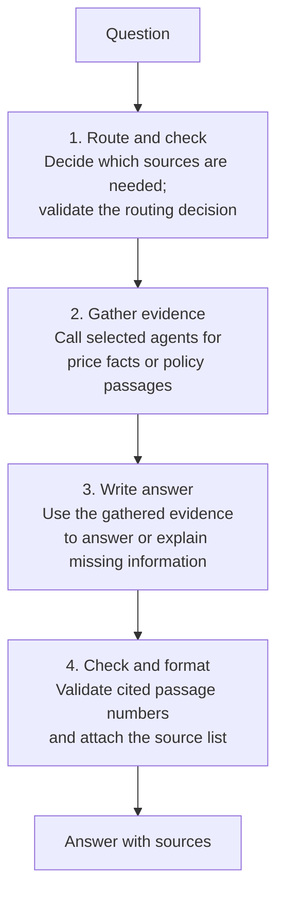
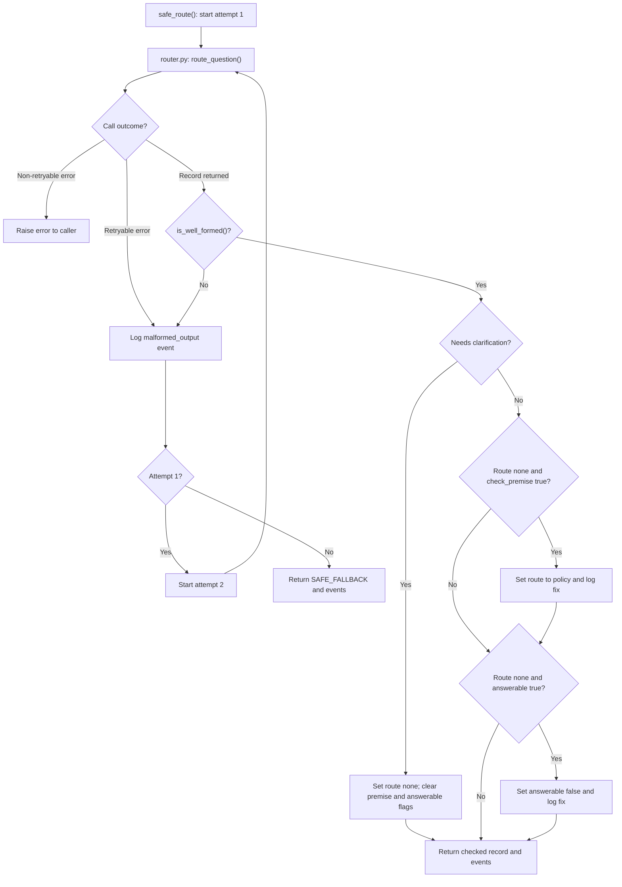
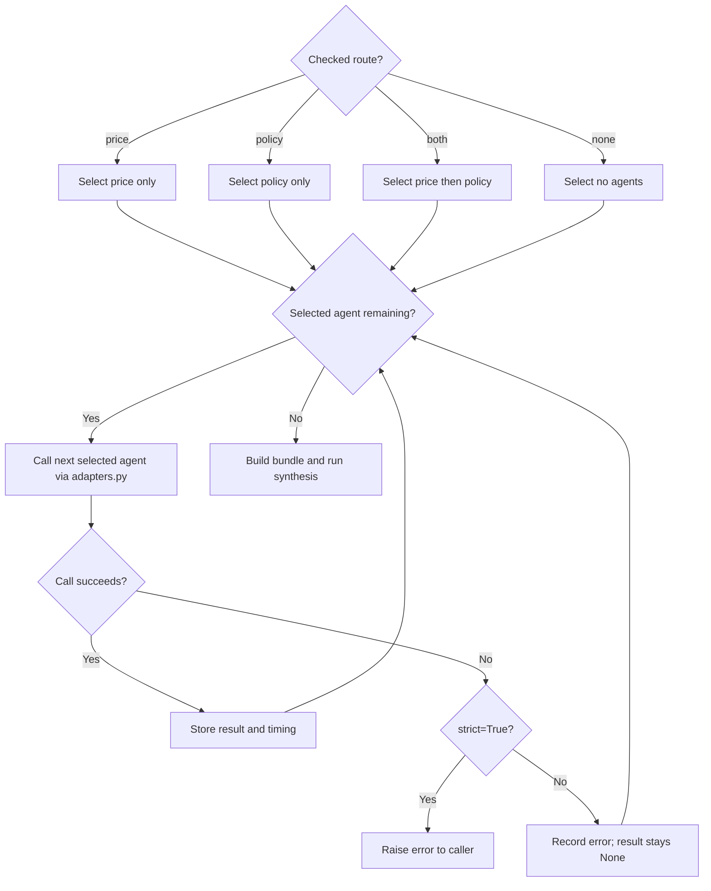
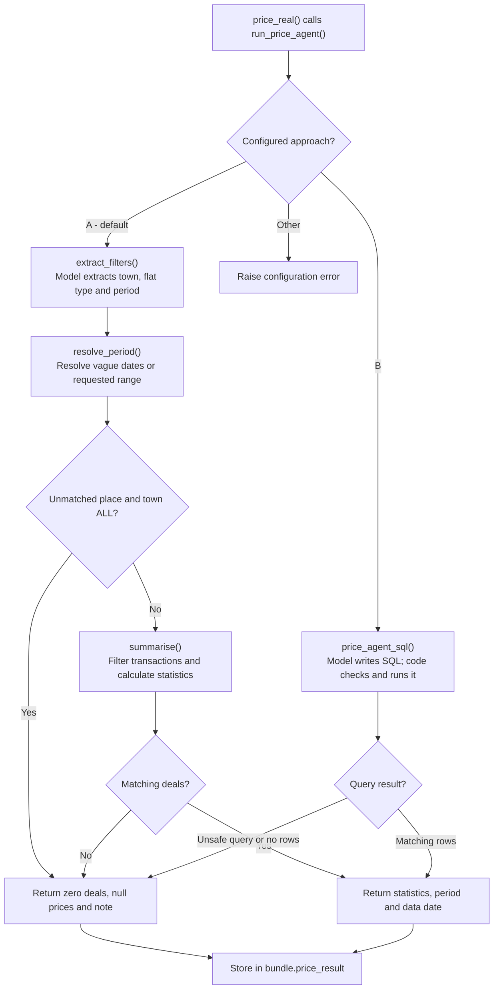
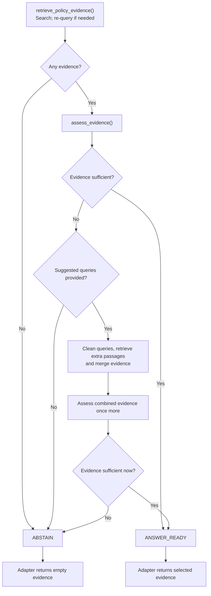
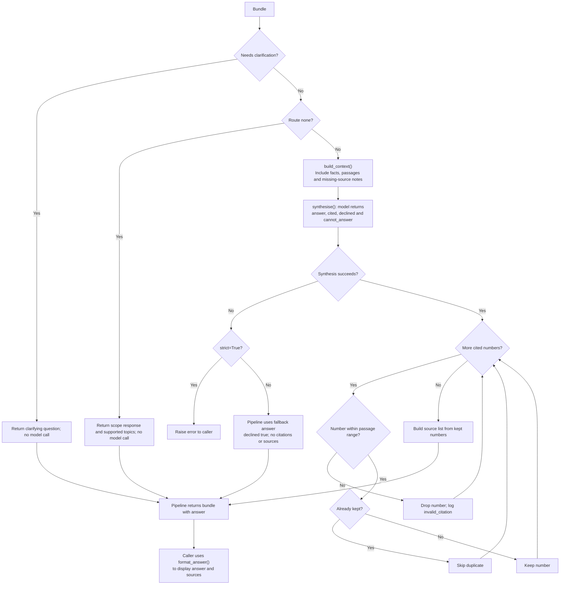

# Supervisor code guide

The supervisor takes a question, selects the evidence it needs, and writes an answer with sources.

Scope: P2 routing, orchestration, synthesis, agent adapters and evaluation. Reviewed against the local code on 31 October 2026; specialist implementation details remain in their own guides.

Start with `handle_question()` in [pipeline.py](../agents/supervisor/pipeline.py). The routing and synthesis prompts define the decision rules; the tables below explain the returned fields.

The flow below is the A baseline. `config.yaml` currently sets
`supervisor.decompose: true`, which adds router-generated focused tasks,
per-task execution and synthesis from all task results (B). Pass
`decompose=False` to run the A baseline.
The paired evaluator runs both variants explicitly. See the [ablation and unseen-question
guide](supervisor_ablation.md) for its interfaces, paired evaluation commands
and team grading workflow. P3's graph (`agents/graph/graph.py`) uses the same
`agents/supervisor/tasks.py` routing/task helpers and config flag, then adds
its own self-check loop. Use `--pipeline graph` in the ablation runner when
evaluating that full workflow.

## 1. High-level flow



The route selects price, policy, both or neither. For `both`, price runs first, then policy; for `none`, evidence gathering is skipped. Both price and policy now use real evidence.

### Code behind each stage

[`pipeline.py`](../agents/supervisor/pipeline.py): `handle_question()` runs the whole flow, collects the bundle and logs timing/errors.

| Stage | Scripts and key functions |
| --- | --- |
| **1. Route and check** | [router.py](../agents/supervisor/router.py): `route_question()` classifies; [checks.py](../agents/supervisor/checks.py): `safe_route()` validates, retries and repairs using `is_well_formed()` and `fix_combinations()` |
| **2. Gather evidence** | [adapters.py](../agents/supervisor/adapters.py): `get_price_agent()` / `get_policy_agent()` select implementations; `price_real()` / `policy_real()` provide results. Price calls `agents.price.run_price_agent()`. Policy calls [policy_agent.py](../src/policy_agent.py): `run_policy_agent()`, which uses `retrieve_policy_evidence()` and `assess_evidence()` |
| **3. Write answer** | [synthesis.py](../agents/supervisor/synthesis.py): `build_context()` prepares evidence; `synthesise()` asks the model to write the answer |
| **4. Check and format** | [synthesis.py](../agents/supervisor/synthesis.py): `check_citations()` validates passage numbers; `synthesise()` builds sources; `format_answer()` formats the display |

Token tracking runs alongside the flow: routing, pricing, policy assessment and synthesis contribute to `bundle["usage"]`. After synthesis, the pipeline calculates `bundle["cost_usd"]` using configured rates.

For example, **“Can I use CPF for a resale flat?”** should route to `policy`. The policy agent searches for relevant passages. Synthesis receives those passages and writes the answer. Code attaches the sources using passage metadata.

Routing calls the model. Synthesis calls it for relevant, sufficiently clear
questions; clarification requests and route `none` use deterministic responses
without a synthesis call. The real price agent calls the model to extract filters
(or write SQL); the policy agent can call the model to assess evidence. Routing
retries can add calls too.

### Detailed flow: routing checks

In `checks.py`, `safe_route()` allows two router attempts. Diamonds show conditions; labelled arrows show the if/else outcomes.



### Detailed flow: agent selection and execution

`pipeline.py` and P3's `graph.py` share `agents/supervisor/tasks.py`: `tasks_for_route()` returns the baseline's one-task-per-selected-agent list (via its `AGENTS_FOR_ROUTE` mapping) or the router's decomposed tasks, and `execute_task()` runs one task through the same success/error branch for both entry points.



Currently, the price call is `price_real()` and the policy call is `policy_real()`. A policy abstention is a successful call with empty evidence, so it follows the success branch above.

### Detailed flow: pricing integration

`adapters.price_real()` calls `agents.price.run_price_agent()` with the question, shared date and usage log. Config selects approach A by default. This chart explains the evidence returned to the supervisor; the [price guide](../agents/price/README.md) owns the specialist details.



Approach A uses the latest configured 12 complete data months for vague or missing periods. An entirely out-of-range period produces no matching deals; it does not forecast a price. Import, data-loading or model errors follow the pipeline's agent-error branch.

`price_result` includes town, flat type, period, median/mean/min/max prices, deal count, data date, extracted filters and a note. Synthesis receives the statistics and note; filters remain available in the bundle for inspection. A zero-deal result is a successful agent call, distinct from `price_result=None` after a failure. Price facts currently have no numbered source entries of their own; the formatted source list is built from policy passage citations.

### Detailed flow: policy evidence decisions

`adapters.policy_real()` calls `src/policy_agent.py: run_policy_agent()` with dense retrieval and LLM assessment enabled. The chart shows that configured path.



The self-correction stage happens at most once, using at most two suggested
queries from the real assessor. It checks the relevance and sufficiency of
supplied passages; it cannot establish that no evidence exists elsewhere in
the corpus. Missing user facts can still permit a conditional answer. Raw
`retrieved_evidence` is retained separately from the selected `evidence`, so
abstention does not hide the retrieved candidates. Policy steps record the
decision and reason; [usage logging](usage_logging.md) explains the CSV fields.
Retrieval/assessment exceptions follow the pipeline's agent-error branch.

### Detailed flow: synthesis and citations

In `synthesis.py`, a clarification request returns the requested clarification
without a model call, and route `none` returns the fixed scope response. For
other routes, missing evidence is described in model context and answering or
declining is a model decision guided by the prompt.



Citation filtering changes the `cited` list and sources, not citation markers inside answer prose. The pipeline returns a bundle; its CLI calls `format_answer()` for display.

## 2. What each file does

All files below are in `agents/supervisor/`.

| File | Main function | Purpose |
| --- | --- | --- |
| [pipeline.py](../agents/supervisor/pipeline.py) | `handle_question()` | Runs the stages and returns the results, errors, timing and token usage |
| [tasks.py](../agents/supervisor/tasks.py) | `tasks_for_route()`, `execute_task()`, `route_with_tasks()`, `resolve_decompose()` | Routing/task helpers shared by `pipeline.py` and P3's `agents/graph/graph.py`, so both entry points select agents, run tasks and read `supervisor.decompose` the same way |
| [router.py](../agents/supervisor/router.py) | `route_question()` | Reads the prompt/settings and asks the model to classify the question |
| [checks.py](../agents/supervisor/checks.py) | `safe_route()` | Validates routing output, retries failures and repairs known contradictions |
| [adapters.py](../agents/supervisor/adapters.py) | `get_price_agent()`, `get_policy_agent()` | Connects the always-real price agent and selectable real/stub policy agent |
| [synthesis.py](../agents/supervisor/synthesis.py) | `synthesise()`, `format_answer()` | Writes the answer, checks citation numbers and formats sources |
| [evaluate.py](../agents/supervisor/evaluate.py) | `run()`, `score()` | Compares routing predictions with labelled questions |
| [score_answers.py](../agents/supervisor/score_answers.py) | `answer_all()`, `score_sheet()` | Generates answer grading sheets and scores reviewed grades |
| [usage_log.py](../agents/supervisor/usage_log.py) | `track_run()`, `append_run()` | Saves local run/call CSV history and policy abstention outcomes |
| [ablation.py](../agents/supervisor/ablation.py) | `run_experiment()`, `score_experiment()` | Runs paired A/B batches and scores independent grades |
| [diagnostics.py](../agents/supervisor/diagnostics.py) | `prepare()`, `summarise()` | Diagnoses saved stages and builds tabular review reports offline |
| [stage_review_excel.py](../agents/supervisor/stage_review_excel.py) | `export_workbook()` | Builds the compact Summary / Review / Agentic Details workbook from saved outputs |
| [judge_tools.py](../agents/supervisor/judge_tools.py) | `run_prepass()`, `run_swap_check()`, `score_against_human()` | Supports reference-gated judging and judge validation; see the specialist guides |

Call `handle_question()` for a complete answer, or `safe_route()` for routing with checks. The router CLI calls `route_question()` directly and is useful for inspecting one raw classification.

### Routing fields and safety checks

The router returns six fields:

| Field | Meaning |
| --- | --- |
| `route` | `price`, `policy`, `both` or `none` |
| `check_premise` | The question states or assumes a claim about rules or prices that must be checked against evidence (it may be true or false; the router does not decide). Facts about the user's own situation do not count |
| `answerable` | Whether the actual question can be answered from the available sources |
| `reason` | The model's explanation for its decision |
| `needs_clarification` | True only when the question is too unclear or underspecified to route with confidence (rule R7); a vague-but-routable question is not enough |
| `clarifying_question` | A short, specific question to resolve the ambiguity, or `null` when `needs_clarification` is false |

A grant amount needs policy evidence. A historical resale price needs transaction evidence. An unanswerable question can still route to an agent for related context.

**R8: nearby-area price estimates.** When an exact street/landmark price is
unavailable, an approximate historical resale-price estimate may use its
containing town or a reliably identified nearby supported area. The routing
reason and price task must retain the requested location and name the proxy
area. The final answer must explicitly describe the substitution, flat type,
period and transaction count, and label it an approximate area-level estimate.
An exact-address request remains unanswerable when only nearby context exists.
Missing location information must be clarified; the prompt does not add a
geocoding or distance-search capability, and it must not invent which area is
closest. Prices still come from transaction results, with no affordability
advice, invented valuations or forecasts.

`safe_route()` follows this sequence:

1. Call the router.
2. If a retryable error occurs or the record is malformed, try once more. After two unsuccessful attempts, return `SAFE_FALLBACK`: `route=none`, `check_premise=False`, `answerable=False`, `needs_clarification=False`, `clarifying_question=None`.
3. Repair known contradictions and return `(record, events)`.

| Contradiction | Repair |
| --- | --- |
| `needs_clarification=True` | Force `route=none`, `check_premise=False`, `answerable=False` — nothing is searched until the user answers |
| `route=none`, `check_premise=True` | Set `route=policy` so evidence can be checked |
| `route=none`, `answerable=True` | Set `answerable=False` |

The clarification repair runs first, then the `check_premise` repair, then the `answerable` repair. If both of the latter two contradictions occur, the result is `policy` and remains answerable.

Retries cover malformed replies, refusals, connection/timeouts, rate limits and server errors. Setup errors such as a wrong key or invalid model propagate to the caller. Events record malformed attempts and repairs.

`needs_clarification`/`clarifying_question` are optional for backward compatibility: a caller supplying its own `route_fn` that skips `safe_route()` (as some tests do) can omit them, and they default to "no clarification needed". Because that caller also bypasses the repair above, `tasks_for_route()` (`agents/supervisor/tasks.py`) carries its own `needs_clarification` guard, returning no tasks regardless of `route`, so clarification is enforced before either agent runs even when the repair didn't.

### Showing what was and wasn't answered

Synthesis always reports, alongside the answer text, which parts of the question it could not answer and why — not just as prose (A3, A4), but as a structured `cannot_answer` list of `{"part", "reason"}` objects that a caller can render as a distinct "Can't answer" section (`format_answer()` does this for CLI output; `ui/app.py`'s `show_main()` renders it as a callout). It is empty when every part of the question was answered.

| Situation | `answer` | `declined` | `needs_clarification` | `cannot_answer` |
| --- | --- | --- | --- | --- |
| Fully answered | the answer | `False` | `False` | `[]` |
| Partly answered (e.g. mixed question, one part out of scope) | the answered part plus an inline note (A4) | `True` | `False` | one entry per unanswered part, each with its reason |
| Out of scope entirely (`route=none`) | `SCOPE_ANSWER` | `True` | `False` | one entry naming the whole question, reason "outside the sources I have" |
| Question too unclear to route | the `clarifying_question` | `True` | `True` | `[]` |

The unclear-question case short-circuits `synthesise()` before any model call or evidence gathering: see `needs_clarification` above.

### Agent configuration and integration

Current [config.yaml](../config.yaml) settings:

```yaml
agents:
  policy: real
  policy_top_k: 10

price_agent:
  approach: A
  default_months: 12
  cleaned_data: data/cleaned/hdb_resale_prices.csv.gz
```

There is no price stub or `agents.price` switch: `get_price_agent()` always returns `price_real()`. Only policy can be switched to `stub`.

- **Price:** `price_real()` calls `run_price_agent()` in [agents/price/__init__.py](../agents/price/__init__.py). The default approach A extracts town, flat type and period with the model, then calculates statistics from `data/cleaned/hdb_resale_prices.csv.gz`. `price_agent.approach: B` selects the SQL alternative. See the [price guide](../agents/price/README.md).
- **Policy:** calls `run_policy_agent()` in [src/policy_agent.py](../src/policy_agent.py), with keyword + embedding search, an automatic re-query when needed, and an LLM evidence check with one possible self-correction pass.

The policy adapter takes the agent's nested `retrieval` result and exposes `evidence` at the top level. It also retains `decision`, `reason` and `trace` in `bundle["policy_result"]`. If the decision is not `ANSWER_READY`, it empties the evidence so synthesis receives no policy passages.

A real policy run needs the chunk corpus, embeddings and local Chroma store. For a fresh clone or changed corpus, build these from the project root:

```bash
python -m scripts.generate_embeddings
python -m scripts.build_chroma_db
```

These read `data_preparation.embedding` and `data_preparation.vector_store` settings. Embeddings and the database are gitignored and must be generated locally. Reuse them for routine questions; rebuild them when the corpus changes. Embedding generation may download the configured model.

### The bundle, errors and token tracking

A **bundle** is the dictionary created inside `handle_question()` in [pipeline.py](../agents/supervisor/pipeline.py). It collects the results of one question, is passed to synthesis, and is returned to the caller. Full answers/evidence remain in memory unless exported. Consumption summaries and stage usage are automatically appended to local CSVs when usage logging is enabled; see the [usage log guide](usage_logging.md).

| Key | Contents |
| --- | --- |
| `question`, `today` | Original question and date shared by the stages |
| `routing` | Checked routing decision |
| `price_result`, `policy_result` | Agent output, or `None` if skipped/failed |
| `agent_errors` | Failures keyed by agent name in A, task ID in B |
| `steps` | Stage timings, events, errors and stub flags |
| `usage` | Router, price, policy-assessor and synthesis input/output token counts |
| `cost_usd` | Estimated cost of recorded usage, added after synthesis |
| `usage_tracking` | Saved usage run ID and paths to summary/stage CSVs, when logging succeeds |
| `answer` | Answer text, `declined`, valid `cited` numbers, `sources`, citation events, `needs_clarification` and the structured `cannot_answer` list (see below) |

With default `strict=False`, agent errors are recorded and processing continues; synthesis errors produce a fallback answer. With `strict=True`, those errors are raised. The pipeline CLI uses strict mode. Routing errors that escape `safe_route()` propagate in either mode.

Token tracking shares one list through the configured stages:

```text
pipeline: usage = []
    -> router: record_usage(..., "router", response)
    -> price adapter: forwards usage_log to filters or SQL call
    -> policy adapter: appends aggregated policy_assessor usage
    -> synthesis: record_usage(..., "synthesis", response)
    -> estimate_cost_usd(usage) after synthesis
    -> bundle["usage"] and bundle["cost_usd"] returned to caller
    -> score_answers.py exports totals and estimated cost per question
```

Router/synthesis use `record_usage()` in `router.py`. Pricing logs `price_filters` or `price_sql`. Policy adds one `policy_assessor` entry with aggregated tokens and a `calls` count, so one entry may represent two assessments. An unselected agent contributes no usage. Injected agent functions must accept `usage_log`; custom model functions must populate it to be counted.

`estimate_cost_usd()` in `router.py` applies `llm.pricing.input_per_1m` and `output_per_1m` from `config.yaml`:

```text
estimated USD = (input tokens × input rate + output tokens × output rate) / 1,000,000
```

This documents the configured calculation, not verified current API prices or an invoice. All recorded calls use the same configured rates; cache discounts and local embedding/compute costs are not calculated. Missing usage counts or rates are treated as zero, so incomplete logs can understate cost. Counts are available for responses returned to the application; exceptions and unreported SDK retries may not be captured.

### What the citation check guarantees

For model-written answers, synthesis receives numbered passages and returns
`answer`, `cited`, `declined` and `cannot_answer` (each unanswered part and its
reason). Code adds sources, events and the clarification flag. Code removes
invalid/duplicate numbers from `cited` and builds the source list from the
corresponding passage metadata.

This checks that citation numbers refer to supplied passages. It does not verify claim support, remove invalid markers inside answer text, or prevent invented links in model-written prose. Answer rules are mainly prompt instructions.

## 3. Run it

Run from the project root with dependencies installed. Model calls require `OPENAI_API_KEY` or `LLM_API_KEY` in your local `.env`.

```bash
source .venv/bin/activate

# Local supervisor tests using fakes; no model calls.
python -m pytest tests/test_supervisor_*.py -q

# Inspect one routing decision.
python -m agents.supervisor.router "Can I use CPF for a resale flat?"

# Full pipeline: routing, selected agents, synthesis.
python -m agents.supervisor.pipeline "Can I use CPF for a resale flat?"
```

From Python:

```python
from agents.supervisor.pipeline import handle_question
from agents.supervisor.synthesis import format_answer

bundle = handle_question("Can I use CPF for a resale flat?")
print(format_answer(bundle["answer"]))
print(bundle["usage"])
print(bundle["cost_usd"])
```

Model settings live under `llm` in `config.yaml`. Optional request settings set to `null` are omitted. See [MAINTENANCE.md](MAINTENANCE.md) for environment setup and the team's Git workflow.

## 4. Evaluate: label, run, grade, score

### Label questions

Add rows to [practice_routing.csv](../data/labels/practice_routing.csv) for tuning. This is the consolidated practice dataset: 54 existing questions and five P1 questions, with stable IDs and the current labels preserved. P1 premise explanations are retained in `rationale`. Keep independently written held-out questions in a separate evaluation file; do not reuse these practice questions as an unseen benchmark.

[Questionaire.xlsx](../data/labels/Questionaire.xlsx) is the matching Excel review copy, with the same 59 questions and nine fields. The CSV remains the evaluation input; edits in Excel are not automatically synced back to it.

The practice CSV uses these nine columns. Keep every header, even if optional cells are blank.

| Column | What to fill |
| --- | --- |
| `question_id` | Required unique, stable ID such as `PR_P2_55` |
| `question` | Required question text; quote CSV cells containing commas |
| `kind` | Optional grouping tag; leave blank if unused |
| `route` | Required expected `price`, `policy`, `both` or `none` |
| `check_premise` | Required TRUE/FALSE: is there a specific claim to check? |
| `premise_false` | TRUE/FALSE after verifying a flagged claim; blank if unverified or not applicable |
| `answerable` | Required TRUE/FALSE: can the actual question be answered from the intended sources? |
| `rationale` | Optional explanation of the expected routing labels |
| `labelled_by` | Optional author initials |

`kind`, `rationale` and `labelled_by` are not automatically filled. Keep the `kind` header because the routing exporter accesses it. The router receives the question, not your expected labels or rationale; its output `reason` explains its own prediction.

`check_premise` is not a truth judgement. A normal question such as “What happens to my CPF when I sell?” does not by itself assert a false rule. User age/income and service availability do not count as premises under v2. Verify `premise_false` using sources, never infer it just because the router flagged a claim. Unverified rows are excluded from myth acceptance, so report that denominator with the score.

Label the actual question: a forecast may be unanswerable even when historical facts provide context. Keep prompt examples out of practice and held-out sets. Previous labels and question-ID mappings are available in Git history.

The empty legacy held-out placeholder was removed. For routing-only evaluation of a new held-out set, use the same nine-column schema above with independently reviewed labels. For end-to-end evaluation, follow the [stage evaluation workflow](stage_evaluation.md) and keep reference answers separate from inference inputs.

### Check routing

```bash
python -m agents.supervisor.evaluate data/labels/practice_routing.csv
```

This makes live router calls and reports field accuracy, all-three accuracy, premise detection (and how many of those were myths), false alarms, repairs/retries, a route confusion table and misses. Results go to `evaluation/results/`.

### Check final answers

1. Generate answers using the current pipeline:

   ```bash
   python -m agents.supervisor.score_answers run data/labels/practice_routing.csv
   ```

2. Open the printed CSV path under `evaluation/answers/`. Read each answer and review `grade_declined`, which is pre-filled from the model's own claim. Fill `grade_myth_accepted` for myth questions (`premise_false` TRUE); leave `n/a` for other rows. Extra columns such as `grader_notes` are allowed.

3. Save the reviewed file, then score it:

   ```bash
   python -m agents.supervisor.score_answers score evaluation/answers/<reviewed-file>.csv
   ```

| Metric | Calculation | Better |
| --- | --- | --- |
| Myth acceptance | Myth questions whose answers accept the false premise / all myth questions | Lower |
| Honesty | Unanswerable questions whose answers decline / all unanswerable questions | Higher |
| Over-refusal | Answerable questions whose answers decline / all answerable questions | Lower |

Required blank grades stop scoring. Pre-filled grades still need human review. Scoring a reviewed sheet makes no model calls; generating answers does. Price always uses real evidence; policy can still be switched to a stub. Older answer sheets with `label_false_belief` remain scoreable as historical runs, but the current label loader requires `check_premise`. A category with no applicable questions has no rate.

If scores worsen, inspect routing, retrieved evidence, agent failures, synthesis and labels before deciding what to change. Keep saved runs for comparison.

### Exports and comparing runs

| Entry point | What is saved |
| --- | --- |
| `pipeline` CLI / `handle_question()` and P3 `graph.run()` | Local `logs/usage/runs.csv` and `calls.csv` usage history when enabled; full bundles are returned, not automatically archived |
| `evaluate` | `evaluation/results/routing_<prompt>_<timestamp>.csv`: question, expected/predicted routing fields, correctness, model reason, event count and seconds |
| `score_answers run` | `evaluation/answers/answers_<timestamp>.csv`: question/labels, route, answer with sources, citation count, errors, stub flags, total tokens, estimated USD, seconds and grading columns |
| `score_answers score` | Prints metrics from reviewed grades; no new report file |

The answer CSV is a summary, not the full bundle: it does not export all
retrieved passages, agent traces or per-stage usage. Use the
[stage-review workflow](stage_evaluation.md) for those details and the compact
Excel report. The [pipeline map](end_to_end_overview.md) links the demo UI.
Exports are UTF-8; in Excel use Data → From Text/CSV and choose UTF-8 if curly
punctuation appears garbled.

Record the code revision, prompts, label revision, agent modes and configured rates alongside each evaluated run. Output filenames contain minute-level timestamps; repeating the same export within a minute can overwrite its earlier file.

Compare v1 `false_belief` and v2 `check_premise` as different tasks. Route/answerable comparisons also need matching questions and labels; raw all-three accuracy across changed schemas is not directly comparable. Keep older stub-price answer runs as historical results and generate new answers to assess real pricing. Review label disagreements before attributing them to the prompt. A successful integration test does not establish factual answer accuracy.

## 5. Change a prompt

| Prompt | Used by |
| --- | --- |
| [supervisor_v2.md](../agents/supervisor/prompts/supervisor_v2.md) | Router: rules R1–R8 and routing examples |
| [synthesis_v2.md](../agents/supervisor/prompts/synthesis_v2.md) | Synthesis: answer rules A1–A9 |
| [decomposition_v1.md](../agents/supervisor/prompts/decomposition_v1.md) | Additional focused-task instructions when decomposition is enabled |

1. Decide which routing or answer rule needs to change and update its explanation alongside the prompt.
2. Edit the active prompt for incremental changes, or create a named new version when the experiment calls for one and update `PROMPT_FILE` in `router.py` or `synthesis.py`. Git history and saved fingerprints preserve obsolete versions; removed v1 routing/synthesis files are not runtime dependencies.
3. If reply fields change, update the JSON schema, prompt, consuming code and tests together. Wording changes alone do not require a schema change.
4. Run supervisor tests, then the relevant live evaluation. Tests with fakes do not measure prompt quality.

Prompts are read at call time and `{today}` is replaced with the shared date.
Code enforces the clarification/routing repairs, deterministic scope and
clarification responses, and citation-number checks. Other routing/answer rules
depend mainly on the model following instructions.

## 6. Troubleshooting

| Problem | Check |
| --- | --- |
| `No model set` | Add `llm.model` in `config.yaml` |
| `No API key found` / authentication error | Check the key in local `.env` |
| Unsupported temperature/seed | Set the optional setting to `null` |
| `No module named 'agents'` | Run from the project root |
| Price data or import failure | Install dependencies and check `price_agent.cleaned_data`; rebuild with `python -m scripts.clean_prices` if the original raw CSV is available |
| Policy import or retrieval failure | Check dependencies, policy modules, embeddings and Chroma store |
| `Ungraded row` | Review `grade_declined` and complete myth grades for known-false premise rows |
| `KeyError: check_premise` | Migrate old input labels to the v2 practice CSV headers |
| Unexpected price-stub warning from answer runner | The current warning still checks the removed `agents.price` setting; price actually always uses `price_real()` |

The router cannot inspect the corpus, so it does not judge whether a claim is true: it only flags claims to check, and synthesis verifies them against retrieved evidence (rule A1). Real policy retrieval is connected, but a successful run alone does not establish answer accuracy.
