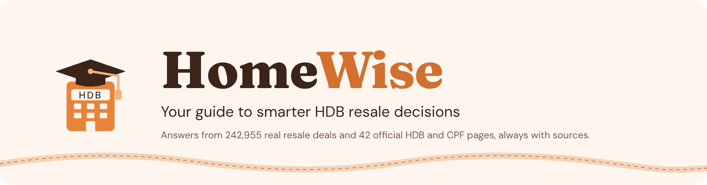
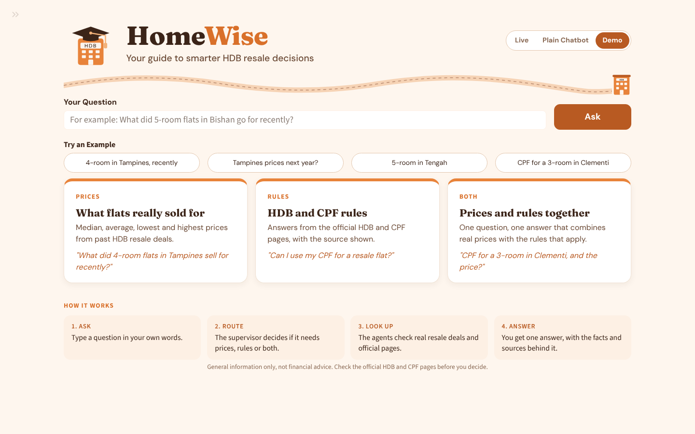
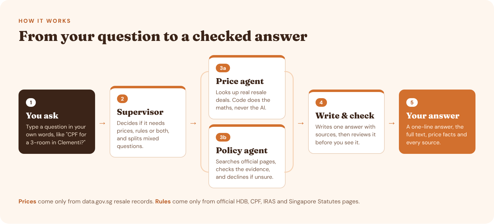
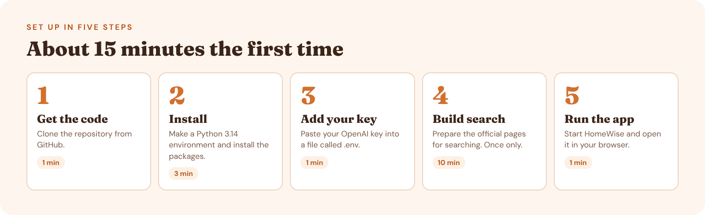
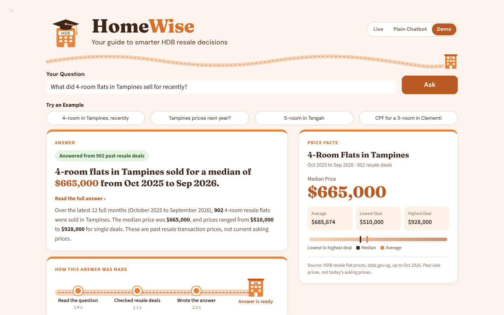
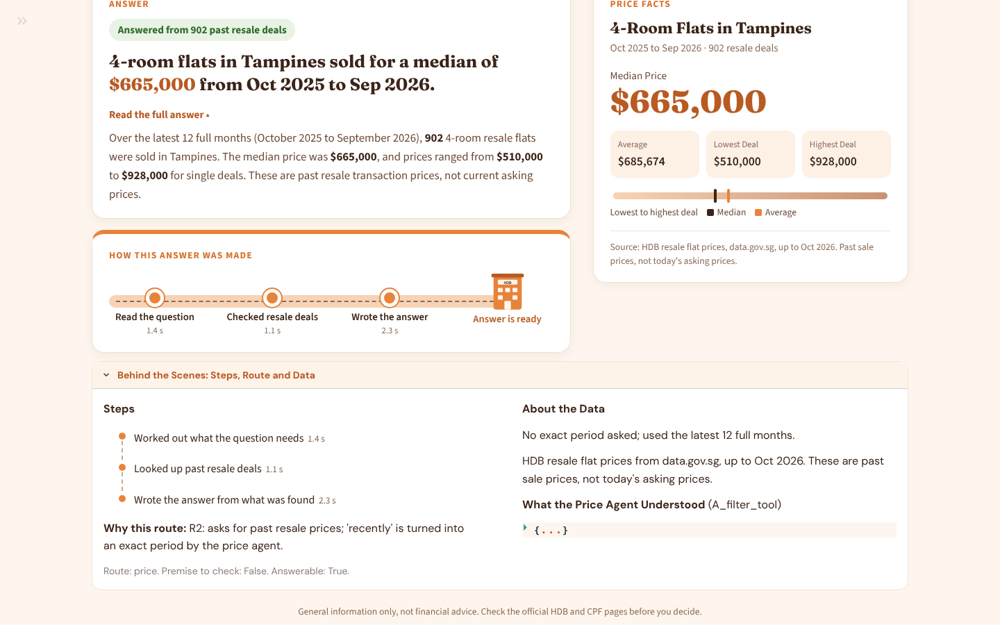
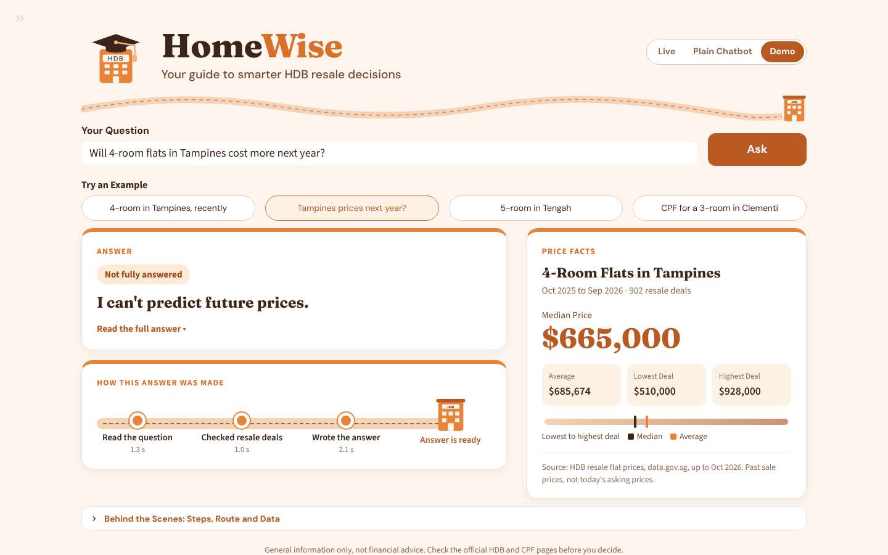
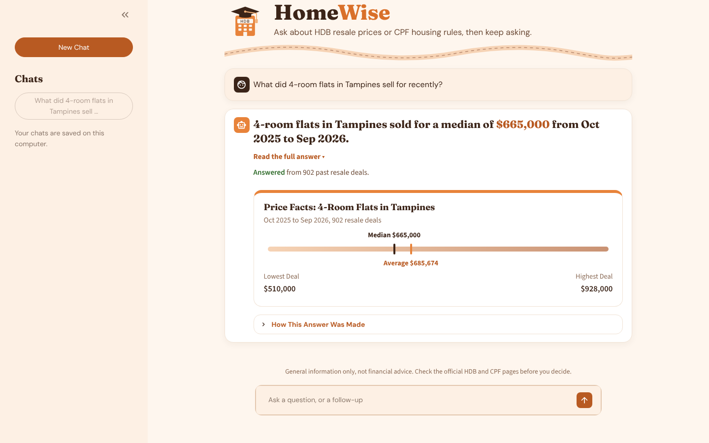
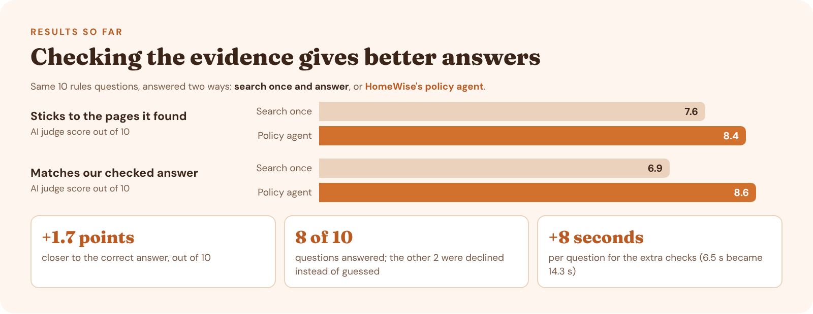

<p align="center">
  
</p>

**HomeWise** answers questions about buying an HDB resale flat in Singapore. Ask it
what flats sold for, what the HDB and CPF rules say, or both at once. It looks the
answer up first, shows you where every fact came from, and tells you plainly when
it cannot answer instead of guessing.

Built for CS614 Generative AI with Large Language Models, Group 1.

<p align="center">
  
</p>

## Contents

| | |
| --- | --- |
| 🏠 [What you can ask](#what-you-can-ask) | 🧪 [Running the tests](#running-the-tests) |
| 🛣️ [How it works](#how-it-works) | 📊 [Running the evaluations](#running-the-evaluations) |
| 🚀 [Quick start](#quick-start) | 🏆 [Results so far](#results-so-far) |
| 🖥️ [Using the app](#using-the-app) | 🛠️ [Troubleshooting](#troubleshooting) |
| 📁 [Project structure](#project-structure) | 📚 [More documentation](#more-documentation) |
| ⚙️ [Settings](#settings) | 👥 [Team](#team) |

## What You Can Ask

| | Type of question | Example | Where the answer comes from |
| --- | --- | --- | --- |
| 💰 | **Prices** | *"What did 4-room flats in Tampines sell for recently?"* | 242,955 real resale deals from data.gov.sg |
| 📜 | **Rules** | *"Can I use my CPF for a resale flat?"* | 42 official HDB, CPF, IRAS and Singapore Statutes pages |
| 🤝 | **Both** | *"Can I use CPF for a 3-room in Clementi, and how much would it cost?"* | Both of the above, combined into one answer |

> [!NOTE]
> HomeWise only uses past sale prices, so it will not predict future prices. Ask
> *"Will prices go up next year?"* and it will say so and show you the latest real
> figures instead.

## How It Works

<p align="center">
  
</p>

Click any part below to see what it does in plain words.

<details>
<summary><b>📦 The data, prepared once before any question</b></summary>
<br>

- **Resale prices:** 242,955 HDB resale transactions from data.gov.sg, cleaned into
  one table. This is the only place price figures come from.
- **Official pages:** 42 pages from HDB, CPF, IRAS and Singapore Statutes Online were
  downloaded, cleaned and cut into 1,282 short passages of a few paragraphs each.
  Every passage keeps its page title and link, so answers can point back to it.
- **Search index:** each passage is turned into numbers that capture its meaning
  (called embeddings, made with the BGE model) and stored in a Chroma database. This
  lets the app find passages by meaning, not just exact words. You build it once in
  [Quick start step 4](#4-build-the-search-index-once).

</details>

<details>
<summary><b>🧭 Supervisor: working out what the question needs</b></summary>
<br>

The supervisor reads the question and picks a route: **prices**, **rules**,
**both**, or **none** (the question is not about HDB resale or CPF housing). It also:

- **Checks hidden assumptions.** A question like *"Since CPF can't be used for resale
  flats..."* assumes a rule. That claim is sent off to be checked, not accepted.
- **Asks when it is truly unclear.** It asks one short follow-up question instead of
  guessing.
- **Splits mixed questions.** A question about both prices and rules becomes one
  focused task for each agent. This is called *decomposition* and is on by default,
  because it makes mixed questions far more likely to be fully answered.

</details>

<details>
<summary><b>💰 Price agent: answering from real deals</b></summary>
<br>

The AI only works out the **town**, **flat type** and **time period** from your
question. Plain code then calculates the median, average, lowest and highest prices
and counts the deals, so the AI never makes up a figure. "Recently" means the latest
12 full months.

There are two versions to compare: **A** fills in a fixed search form, and **B**
writes its own database query (known as text-to-SQL).

</details>

<details>
<summary><b>📜 Policy agent: answering from official pages</b></summary>
<br>

It searches the passages, then asks the AI: *is this really enough to answer?* If not,
it splits the question into smaller parts and searches again. If the evidence is
still not enough, it says it cannot answer rather than guessing. See how well this
works in [Results so far](#results-so-far).

</details>

<details>
<summary><b>✍️ Writing and checking the answer</b></summary>
<br>

- **Writing:** one answer is written from everything the agents found. Every rule it
  mentions must point to a numbered passage. Code then checks each of these
  citations and removes any that point nowhere. The source list is added by code,
  not by the AI.
- **Self-check:** before you see it, the answer is reviewed. Quick code checks come
  first (errors, removed citations, sources that were never used). If those pass,
  the AI reviews the answer against the answering rules. If something is wrong, the
  responsible step is run again once.

</details>

<details>
<summary><b>💬 Chat memory and cost tracking</b></summary>
<br>

- **Chat memory (Chat button and chat page):** a follow-up like *"What about Bishan?"* is
  rewritten into a full question using the last few messages, so the agents know
  what you mean. Chats are saved on your own computer.
- **Cost and speed:** every AI call records its tokens, cost and time in
  `logs/usage/`, and the app shows how long each step took.

</details>

For the full technical map, see [Docs/end_to_end_overview.md](Docs/end_to_end_overview.md).

## Quick Start

<p align="center">
  
</p>

**Before you start, you need:**

- [ ] **Python 3.14** ([download](https://www.python.org/downloads/)). Other versions
      may fail to install some packages.
- [ ] **Git** ([download](https://git-scm.com/downloads))
- [ ] **An OpenAI API key** for live answers ([get one](https://platform.openai.com/api-keys)).
      No key? You can still try the app in Demo mode.

### 1. Get the code

```bash
git clone https://github.com/edwardbyl00/Gen-AI-and-LLM-Project.git
cd Gen-AI-and-LLM-Project
```

### 2. Install

This makes a private Python environment for the project (`.venv`) and installs
everything it needs into it.

<details open>
<summary><b>🪟 Windows (PowerShell)</b></summary>

```powershell
py -3.14 -m venv .venv
Set-ExecutionPolicy -Scope Process -ExecutionPolicy Bypass
.\.venv\Scripts\Activate.ps1
pip install -r requirements.txt
```

</details>

<details>
<summary><b>🍎 macOS / 🐧 Linux</b></summary>

```bash
python3.14 -m venv .venv
source .venv/bin/activate
pip install -r requirements.txt
```

</details>

> [!TIP]
> You know it worked when your terminal line starts with `(.venv)`. Every time you
> open a new terminal, run the activate line again before using the project.

### 3. Add your API key

Make your own copy of the settings file:

```bash
cp .env.example .env          # Windows: Copy-Item .env.example .env
```

Open `.env` in any text editor and paste your key after the equals sign:

```text
OPENAI_API_KEY=sk-...
```

> [!IMPORTANT]
> Never share or commit `.env`. It holds your private key. It is already listed in
> `.gitignore`, so Git ignores it.

### 4. Build the search index (once)

The price data is already in the repository. The search index for the official
pages is not, because it is large and built for your own computer. Build it once:

```bash
python -m scripts.generate_embeddings
python -m scripts.build_chroma_db
```

The first command downloads the BGE model and processes all 1,282 passages. It takes
about 10 minutes on a laptop and needs no API key.

### 5. Run the app

```bash
streamlit run ui/app.py
```

Your browser opens at `http://localhost:8501`. Type a question or click an example. 🎉

## Using the App

### The answer page

<p align="center">
  
</p>

| What you see | What it means |
| --- | --- |
| **Green or orange label** | Green means it answered, and how many deals it used. Orange means it could not fully answer. |
| **Bold one-line answer** | The short answer. Click **Read the full answer** for the details and sources. |
| **Price Facts** (right) | The median price in large type, plus average, lowest and highest deal. Only shown when real deals were found. |
| **How This Answer Was Made** | Each step as a stop on a road, with how long it took. A step that failed turns red. |
| **Behind the Scenes** | The full step log, which route was chosen and why, and what the price agent understood. |

<details>
<summary><b>📸 More screenshots</b></summary>
<br>

**Behind the Scenes, opened**



**When it cannot answer:** it says so plainly and still shows the real figures.



</details>

### Three modes

Switch with the buttons at the top right of the page.

| Mode | What it does | Needs a key? |
| --- | --- | :---: |
| **Live** | The full HomeWise system, one question at a time. Starts here when a key is found. | ✅ |
| **Chat** | The full HomeWise system as a chat: ask follow-ups like *"What about Bishan?"* under each answer. Chats are saved and listed in the side panel. | ✅ |
| **Demo** | Three saved answers built from the real price data. A safe backup if the internet or API is down. | ❌ |

The **»** at the top left opens a side panel where you can switch the price agent
between version A and version B.

### The chat page

The **Chat** button on the main page is the same chat. You can also run it on its own
page (one page at a time):

```bash
streamlit run ui/chat_app.py
```

<p align="center">
  
</p>

## Project Structure

```text
Gen-AI-and-LLM-Project/
├── agents/
│   ├── supervisor/     Router, decomposition, answer writing, checks, evaluation tools
│   ├── price/          Price agent: version A (search form) and B (text-to-SQL)
│   ├── graph/          LangGraph pipeline, self-check, chat memory
│   └── baselines/      Plain chatbot, for comparison
├── src/                Policy agent: search, evidence check, declining when unsure
├── scripts/            Data cleaning, passages, embeddings and the search index
├── data/
│   ├── cleaned/        Cleaned official pages and the resale price table
│   ├── processed/      The 1,282 passages (chunks.jsonl)
│   └── labels/         Labelled practice questions
├── evaluation/         Test questions, correct answers, evaluation scripts, results
├── ui/                 The main page and the chat page
├── tests/              Automated tests (no API calls)
├── Docs/               Guides for each part of the system
├── config.yaml         All settings in one place
└── requirements.txt    Exact package versions
```

Made on your own computer and kept out of Git: `.env`, `.venv/`,
`data/embeddings/`, `data/vector_db/`, `logs/` and `reports/`.

## Settings

Every setting lives in [config.yaml](config.yaml), so nothing is hidden in the code.
The ones you are most likely to change:

| Setting | Default | What it does |
| --- | --- | --- |
| `llm.model` | `gpt-5.4-2026-03-05` | The AI model. One fixed version is used everywhere, so results can be repeated. |
| `llm.temperature`, `llm.seed` | `0`, `42` | Makes the AI give the same output for the same input. |
| `supervisor.decompose` | `true` | Split mixed questions into one task per agent. |
| `agents.policy` | `real` | Set to `stub` to run without the search index. |
| `agents.policy_top_k` | `10` | How many passages each search returns. |
| `price_agent.approach` | `A` | `A` = search form, `B` = text-to-SQL. |
| `price_agent.default_months` | `12` | What "recently" means: the latest 12 full months. |
| `self_check.max_retries` | `1` | How many times a weak answer is redone. |

## Running the Tests

```bash
python -m pytest
```

The tests make no API calls, so they are free to run. The search tests need the
index from [Quick start step 4](#4-build-the-search-index-once). To run every
regression check in one go, use `python tests/run_all.py`.

## Running the Evaluations

> [!WARNING]
> Evaluations call the AI many times and use API credit. Results are saved under
> `evaluation/`.

| What it compares | Command | Guide |
| --- | --- | --- |
| Price agent A vs B vs plain chatbot | `python -m evaluation.evaluate_price_agents` | [agents/price/README.md](agents/price/README.md) |
| Plain chatbot grading sheet | `python -m evaluation.run_chatbot_baseline data/labels/practice_routing.csv` | [agents/price/README.md](agents/price/README.md) |
| Splitting questions on vs off | `python -m agents.supervisor.ablation run <questions.csv> --pipeline graph --out <folder>` | [supervisor_ablation.md](Docs/supervisor_ablation.md), [stage_evaluation.md](Docs/stage_evaluation.md) |
| Policy agent vs searching once | `python scripts/evaluate_agentic_answers.py --judge` (set the path first, below) | [policy_agent_rag.md](Docs/policy_agent_rag.md) |
| Search methods | `python scripts/evaluate_dense_retrieval.py`, `python scripts/evaluate_advanced_retrieval.py` | [policy_agent_rag.md](Docs/policy_agent_rag.md) |

The policy agent evaluation needs this line first, in the same terminal:

```powershell
$env:PYTHONPATH=".;src"          # Windows PowerShell
```

```bash
export PYTHONPATH=".:src"        # macOS / Linux
```

Every run also logs tokens and cost to `logs/usage/`. See
[usage_logging.md](Docs/usage_logging.md).

## Results So Far

<p align="center">
  
</p>

**What was tested:** the same 10 rules questions were answered two ways. The first
searches the official pages once and answers from whatever comes back. The second
is HomeWise's policy agent, which checks the evidence, searches again when it is not
enough, and declines when it is still unsure. A second AI acted as the judge and
scored each answer out of 10.

**What we found:** checking the evidence made answers clearly more accurate, at the
cost of about 8 extra seconds per question. The agent answered 8 questions and
declined 2 where the pages did not hold enough information. Across three repeat
runs, it made the same answer-or-decline decision 96.7% of the time.

<details>
<summary><b>Things we tried that did not help</b></summary>
<br>

- **Mixing keyword search with meaning search** (hybrid retrieval) did not find
  better pages than meaning search alone. We report that honestly rather than
  tuning it until it looked better.
- **Filtering pages by date** is built in, but the official pages do not say when
  each rule took effect, so it could not be used. The date a page was downloaded is
  not treated as the date a rule started.

</details>

Detailed results: `evaluation/agentic/` and `evaluation/retrieval/`. Full write-up:
[Docs/policy_agent_rag.md](Docs/policy_agent_rag.md).

> [!NOTE]
> Results for the price agent (A vs B vs plain chatbot) and for splitting questions
> will be added here once those evaluations are run.

## Troubleshooting

<details>
<summary><b>The policy step turns red with "Could not connect to tenant default_tenant", or keeps declining questions it should answer</b></summary>
<br>

The search index on your computer is out of date or damaged. Stop the app, delete
the folders `data/embeddings/` and `data/vector_db/`, then run both commands in
[Quick start step 4](#4-build-the-search-index-once) again.

</details>

<details>
<summary><b>The first question takes a minute or more</b></summary>
<br>

The first question loads the search model. Later questions are faster. Before a
demo, ask one question to warm it up.

</details>

<details>
<summary><b>"Add OPENAI_API_KEY or LLM_API_KEY to .env"</b></summary>
<br>

Check that `.env` is in the main project folder, is named exactly `.env` (Windows
sometimes saves it as `.env.txt`), and contains `OPENAI_API_KEY=` followed by your
key. Then restart the app.

</details>

<details>
<summary><b><code>pip install</code> fails on <code>lxml</code> or <code>pyyaml</code> (Windows)</b></summary>
<br>

You are not on Python 3.14. Delete the `.venv` folder and recreate it with
`py -3.14 -m venv .venv`.

</details>

<details>
<summary><b><code>Activate.ps1</code> cannot be loaded because running scripts is disabled</b></summary>
<br>

Run `Set-ExecutionPolicy -Scope Process -ExecutionPolicy Bypass` in the same
PowerShell window first. It only lasts for that window.

</details>

<details>
<summary><b>One test, <code>test_prepared_report_has_readable_stage_and_quality_tables</code>, fails only on Windows</b></summary>
<br>

A known text-encoding issue inside that test. It does not affect the app.

</details>

## More Documentation

| Guide | What it covers |
| --- | --- |
| [end_to_end_overview.md](Docs/end_to_end_overview.md) | How every part fits together. **Start here.** |
| [ui/README.md](ui/README.md) | The main page and chat page |
| [agents/price/README.md](agents/price/README.md) | Price agent, price data and its evaluation |
| [supervisor_guide.md](Docs/supervisor_guide.md) | Routing, splitting questions and writing answers |
| [policy_agent_rag.md](Docs/policy_agent_rag.md) | Policy agent design and evaluation |
| [data_prep_policy_handoff.md](Docs/data_prep_policy_handoff.md) | Preparing the official pages |
| [supervisor_ablation.md](Docs/supervisor_ablation.md) | Splitting questions on vs off |
| [stage_evaluation.md](Docs/stage_evaluation.md) | Step-by-step evaluation workflow |
| [llm_judge_validation.md](Docs/llm_judge_validation.md) | Checking the AI judge |
| [usage_logging.md](Docs/usage_logging.md) | Token and cost logs |
| [price_agent_synthesis_review.md](Docs/price_agent_synthesis_review.md) | How price facts appear in answers |
| [MAINTENANCE.md](Docs/MAINTENANCE.md) | Team conventions: settings, Git, pull requests |
| [CHANGELOG.md](Docs/CHANGELOG.md) | What changed and why |

## Team

Built by **Lim Boon Yan Edward, Hew Wee Ming, Htet Kay Khaing, Maria Mustafa Doola
and Su Bo-Han**. The work was split into five parts:

| | Part | What it covers |
| --- | --- | --- |
| 💰 | **Price data and price agent** | Resale price data, price agent (A and B), plain chatbot, price evaluation, HomeWise interface |
| 🧭 | **Supervisor** | Routing, splitting questions, writing answers, end-to-end evaluation |
| 🔁 | **Pipeline and chat** | LangGraph pipeline, self-check, chat memory and chat page |
| 📦 | **Policy data** | Collecting, cleaning and splitting the official pages, building embeddings |
| 📜 | **Policy agent** | Searching the pages, checking the evidence, searching again, declining when unsure |

---

<p align="center"><sub>General information only, not financial advice. Check the official HDB and CPF pages before making a housing decision.</sub></p>
